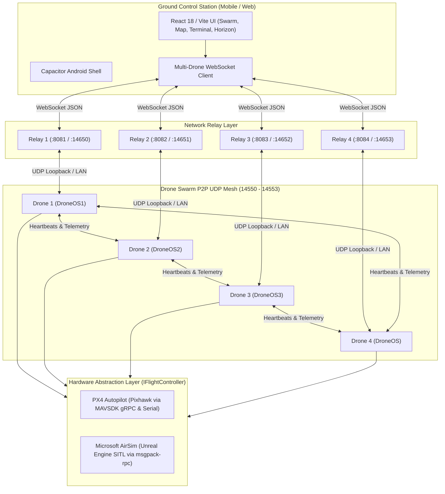

# PhoneOS Swarm (DroneSwarm) Documentation

Welcome to the comprehensive technical documentation and engineering handoff for **PhoneOS Swarm** (repository: `Debanshu2005/DroneSwarm`). This repository houses a production-grade, distributed autonomous drone operating system (`DroneOS`), a high-performance ground control station (`mobile`), network bridges (`relay`), and complete 3D simulation testbeds (`sim`).

---

## Documentation Navigation Matrix

```
doc/
├── README.md                           # Master index and documentation map (this file)
│
├── architecture/                       # Deep architectural specifications & design patterns
│   ├── system-overview.md              # End-to-end topology, dataflow, and 4-node design
│   ├── droneos-internals.md            # Pipeline, FlightState, SafetyFilter, Arbiter, Managers
│   ├── swarm-coordination-healing.md   # Quorum, Anchor Election, Formations & Self-Healing Engine
│   ├── communication-and-protocols.md  # P2P UDP mesh, Relay bridge, WebSocket, and Pydantic schemas
│   ├── flight-adapters.md              # Hardware abstraction: PX4/MAVSDK, AirSim, and Mock
│   └── mobile-gcs-architecture.md      # React / Capacitor Ground Control Station architecture
│
├── guides/                             # Operational runbooks and step-by-step guides
│   ├── developer-quickstart.md         # 5-minute setup, dependencies, and local testing
│   ├── airsim-simulation-guide.md      # Launching, controlling, and testing 4 drones in AirSim
│   ├── hardware-deployment.md          # Raspberry Pi provisioning, systemd services, Pixhawk wiring
│   ├── gcs-user-guide.md               # Operating the mobile GCS, formations, and NLP terminal
│   └── configuration-reference.md      # Comprehensive YAML profile & key reference guide
│
└── handoff/                            # Critical engineering handoff and maintenance documentation
    ├── engineering-handoff.md          # Current status, code invariants, and conventions
    ├── testing-and-verification.md     # Pytest test suites, coverage, and smoke tests
    └── troubleshooting-and-faq.md      # Diagnostic runbook, error codes, and troubleshooting
```

---

## High-Level System Architecture



---

## Repository Quick Summary

| Component | Directory | Purpose | Core Tech Stack |
|---|---|---|---|
| **DroneOS Base** | `DroneOS/` | Core flight management, pipeline, safety, and coordination | Python 3.10+, Asyncio, Pydantic, PyYAML |
| **Mirrored Instances** | `DroneOS1/`, `DroneOS2/`, `DroneOS3/` | Independent runtime packages for multi-drone deployment | Zero cross-package imports |
| **Mobile GCS** | `mobile/` | Ground Control Station UI with live telemetry, horizon, terminal | React 18, Vite, Capacitor 6, Leaflet, Lucide |
| **Relay Bridge** | `relay/` | Bidirectional UDP $\leftrightarrow$ WebSocket communication bridge | Python, websockets, asyncio, hmac |
| **Simulation** | `sim/`, `AirSim/` | 4-drone multi-agent SITL simulation in Unreal Engine | Microsoft AirSim, msgpack-rpc |
| **Deployment** | `deploy/` | Systemd service units, autostart, and setup automation | Bash, Systemd (Raspberry Pi OS) |
| **Test Suites** | `DroneOS*/tests/` | 1,100+ comprehensive unit, integration, and property tests | pytest, pytest-asyncio, hypothesis |

---

## Where to Begin

- **For New Developers:** Read the [Developer Quickstart](guides/developer-quickstart.md) and [System Overview](architecture/system-overview.md).
- **For Simulation Testers:** Follow the [AirSim Simulation Guide](guides/airsim-simulation-guide.md).
- **For Field Deployment & Ops:** Follow the [Hardware Deployment Guide](guides/hardware-deployment.md).
- **For Flight Controllers & Swarm Engineers:** Study [DroneOS Internals](architecture/droneos-internals.md) and [Swarm Coordination & Healing](architecture/swarm-coordination-healing.md).
- **For Incoming Maintainers:** Review the [Engineering Handoff Document](handoff/engineering-handoff.md) and [Troubleshooting Runbook](handoff/troubleshooting-and-faq.md).
