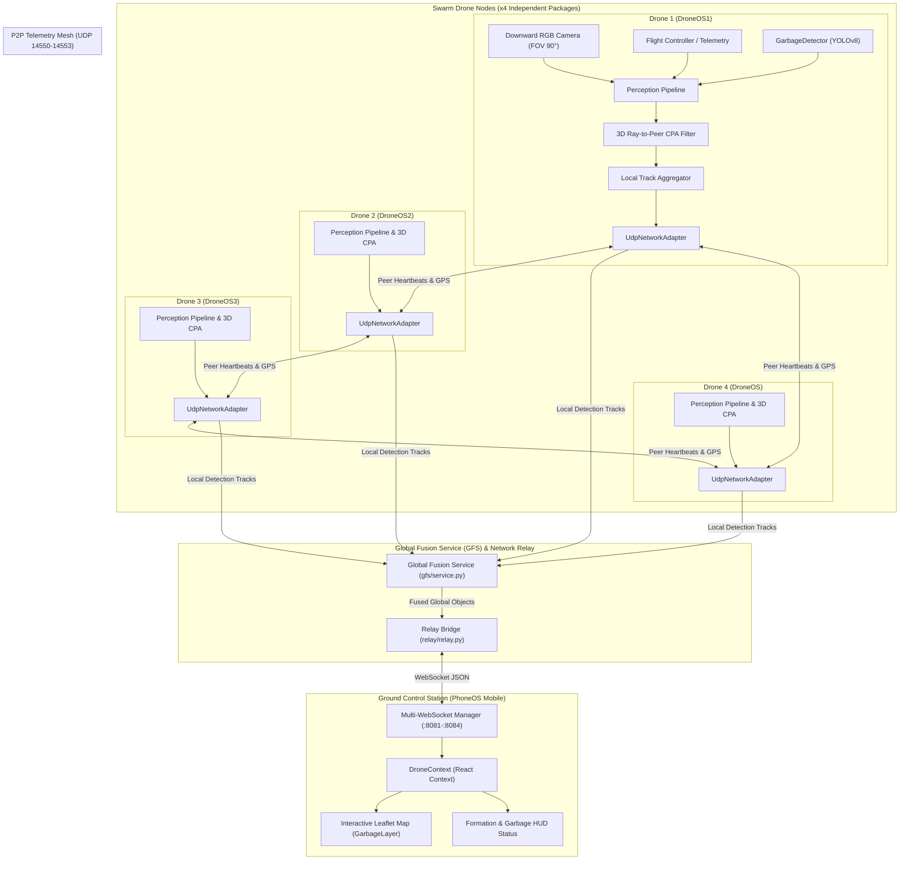
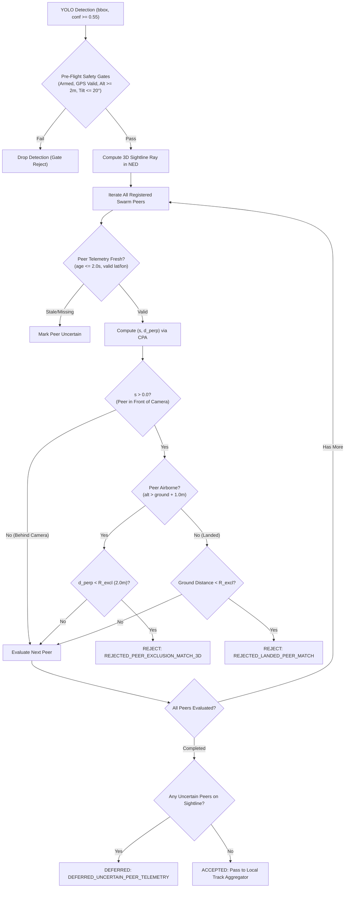

# Architecture: Collaborative Swarm Perception & 3D Peer-Exclusion Subsystem

## 1. Executive Summary & Problem Formulation

In autonomous multi-drone operations, aerial perception pipelines are tasked with detecting ground targets (such as municipal garbage, debris, or search-and-rescue objects) while flying in tight spatial formations.

During multi-drone formation flight (e.g. V-formation, column, or diamond at varying flight levels), aircraft are frequently positioned at different altitudes directly or partially above one another (e.g. Drone 1 cruising at $15.8\text{ m}$ AGL, while Drone 2, 3, and 4 maneuver at $5\text{–}10\text{ m}$ AGL).

```
                      [Drone 1 (Observer at 15.8m AGL)]
                                     |
                                     | Camera Sightline (Ray)
                                     v
                       [Drone 2 (Peer at 5.0m AGL)]
                                     |
                                     v
                     ================================= Ground Plane (0.0m)
                              [Projected False Target]
```

### The Root Defect: Phantom Detections During Formation
When genuine garbage targets were spawned on the ground, the mobile Ground Control Station (GCS) initially displayed the correct count (e.g. **`GARBAGE (2)`**). However, as soon as the swarm formed up:
1. Upper drones' downward-facing cameras captured the airframes of lower peer drones.
2. The onboard YOLO object detector misclassified the dark motors, carbon fiber arms, and battery packs of the peer drones as `"rubbish"`.
3. The legacy 2D ground projection pipeline projected these detections to the flat ground plane at $Z = 0$, miscalculating their ground positions.
4. The system reported all four drones as ground garbage targets, escalating the count to **`GARBAGE (6)`** ($2\text{ genuine targets} + 4\text{ peer drones}$).

To permanently solve this defect across all operational flight envelopes, PhoneOS Swarm integrates a **3D Camera-Ray Closest-Point-of-Approach (CPA) Peer-Exclusion Filter** coupled with a **Global Fusion Service (GFS)** for multi-view collaborative confirmation.

---

## 2. End-to-End System Architecture

The collaborative perception subsystem spans the onboard companion computers, network relay bridges, global fusion engines, and the mobile Ground Control Station:



---

## 3. Mathematical Foundations: 3D Ray-to-Peer Closest Point of Approach (CPA)

The 3D peer exclusion filter operates by computing the geometric proximity between the camera sightline ray (in 3D space) and the 3D bounding sphere/cylinder of every known peer drone in the swarm mesh.

### 3.1 Pinhole Unprojection to World Sightline Vector
Let an image frame have width $W$ and height $H$, with camera horizontal field of view $\text{HFOV}$.
The camera focal length in pixels is:
$$f_x = \frac{W}{2 \tan(\text{HFOV} / 2)}, \quad f_y = f_x$$

For a detected bounding-box center $(u, v)$, the normalized camera-frame ray is:
$$\vec{r}_{\text{cam}} = \begin{bmatrix} \frac{u - W/2}{f_x} \\ \frac{v - H/2}{f_y} \\ 1 \end{bmatrix}, \quad \hat{r}_{\text{cam}} = \frac{\vec{r}_{\text{cam}}}{\|\vec{r}_{\text{cam}}\|}$$

### 3.2 Coordinate Transformations (Camera $\to$ Body $\to$ NED)
1. **Camera Mount Pitch ($R_y(-\theta_{\text{mount}})$):**  
   Transforms from the camera frame to the aircraft body frame. For a nadir downward-facing camera ($\theta_{\text{mount}} = 90^\circ$):
   $$\vec{r}_{\text{body}} = R_y(-90^\circ) \hat{r}_{\text{cam}}$$
2. **Aircraft Attitude ($R_{\text{body}\to\text{NED}} = R_z(\psi) R_y(\theta) R_x(\phi)$):**  
   Rotates the vector from body coordinates to the North-East-Down (NED) world frame using instantaneous yaw ($\psi$), pitch ($\theta$), and roll ($\phi$):
   $$\hat{r}_{\text{NED}} = R_{\text{body}\to\text{NED}} \vec{r}_{\text{body}}$$

### 3.3 3D Ray-to-Point CPA Derivation
Let the observing drone's camera nodal position in NED be $\vec{o} = (N_{\text{obs}}, E_{\text{obs}}, D_{\text{obs}})$.  
Let a peer drone's position in NED (derived from its live GPS telemetry) be $\vec{p} = (N_{\text{peer}}, E_{\text{peer}}, D_{\text{peer}})$.

The relative translation vector from camera to peer is:
$$\vec{w} = \vec{p} - \vec{o}$$

The orthogonal scalar projection of $\vec{w}$ onto the unit camera ray $\hat{r}_{\text{NED}}$ gives the **along-ray depth** $s$:
$$s = \vec{w} \cdot \hat{r}_{\text{NED}} = w_N r_N + w_E r_E + w_D r_D$$

The orthogonal miss distance $d_\perp$ from the peer center to the camera ray is:
$$d_\perp = \sqrt{\|\vec{w}\|^2 - s^2}$$

```python
def compute_ray_to_point_cpa(
    ray_dir_ned: Tuple[float, float, float],
    point_ned: Tuple[float, float, float],
    ray_origin_ned: Tuple[float, float, float] = (0.0, 0.0, 0.0),
) -> Tuple[float, float]:
    w = (
        point_ned[0] - ray_origin_ned[0],
        point_ned[1] - ray_origin_ned[1],
        point_ned[2] - ray_origin_ned[2],
    )
    s = w[0] * ray_dir_ned[0] + w[1] * ray_dir_ned[1] + w[2] * ray_dir_ned[2]
    w_sq = w[0] ** 2 + w[1] ** 2 + w[2] ** 2
    if s <= 0.0:
        return s, math.sqrt(w_sq)
    d_perp_sq = max(0.0, w_sq - s ** 2)
    return s, math.sqrt(d_perp_sq)
```

---

## 4. Perception Pipeline Filtering Logic & Decision Matrix

Each perception step evaluates all detections against the live peer swarm registry:



### 4.1 State Handling & Operational Guarantees
1. **Airborne Peer Exclusion ($d_\perp < 2.0\text{ m}$):** Rejects detections along the sightline cylinder to prevent peer airframes from becoming false targets.
2. **Landed Peer Protection:** For disarmed/landed drones on the terrain, exclusion shifts to 2D Euclidean ground distance, preventing landed drones from being marked as rubbish while protecting genuine garbage nearby.
3. **Telemetry Age Gating (`max_telemetry_age_s = 2.0s`):** If a peer's heartbeat or GPS updates stall, detections along ambiguous sightlines are marked `DEFERRED` rather than prematurely emitting unverified global targets.

---

## 5. Depth Ambiguity & The Sensor Measurement Contract

### 5.1 Optical Monocular Indeterminacy
A single monocular 2D camera cannot measure distance along its line of sight without prior knowledge of the object's physical dimensions:
$$w_{\text{px}} = \frac{f_x \cdot W}{s}$$
- A peer drone ($W = 0.65\text{ m}$) at along-ray depth $s = 10.0\text{ m}$ produces a $16.64\text{ px}$ bounding box.
- A garbage bag ($W = 1.00\text{ m}$) at along-ray depth $s = 15.38\text{ m}$ produces the identical $16.64\text{ px}$ bounding box.

Because open-world litter varies in size from small cans ($0.06\text{ m}$) to large illegal dumping ($>2.0\text{ m}$), **bounding-box pixel scale cannot resolve metric depth**.

### 5.2 Scenario 2 (Foreground Garbage with Peer Behind It)
In the scenario where genuine garbage is located at $s = 10\text{ m}$ (e.g. an elevated structure) and a peer drone is at $s = 15\text{ m}$ along the same sightline:
- **Depth Ordering:** $s_{\text{cam}} (0\text{m}) < s_{\text{fg}} (10\text{m}) < s_{\text{peer}} (15\text{m}) < s_{\text{ground}} (20\text{m})$.
- **Behavior:** The single observing drone suppresses the detection because its sightline pierces the peer's exclusion cylinder.
- **Why This Trade-Off is Necessary:** If the filter permitted detections along peer sightlines, every normal formation flight would convert lower peer drones into phantom garbage targets (`GARBAGE (6)`).
- **The Swarm Solution:** While Drone 1's sightline is aligned with Drone 2, **Drone 3 and Drone 4 (operating on a 15–25 m baseline) view the foreground garbage from oblique angles** where $d_\perp \gg 2.0\text{ m}$. Drones 3 and 4 confirm the target via GFS fusion without false alarms.

---

## 6. Global Fusion Service (GFS) & Network Relay

### 6.1 Epipolar Multi-View Aggregation
The Global Fusion Service (`gfs/service.py`) receives local track reports from all active drones over UDP/loopback:
1. **Spatial Clustering:** Matches incoming local tracks against existing global objects using geographic distance ($R_{\text{fusion}} \le 2.5\text{ m}$).
2. **Multi-Drone Voting:** Tracks observed by multiple distinct drones increment confidence and confirmation status.
3. **Epoch & Session Safety:** Each flight session possesses a monotonic generation ID; stale tracks from previous runs are cleanly evicted.
4. **Relay Forwarding:** Confirmed targets are serialized to WebSocket JSON and pushed to the mobile GCS.

### 6.2 Mobile Ground Control Station Display (`mobile/`)
The React/Capacitor mobile GCS maps targets in real time:
- **`GARBAGE (N)` Counter:** Displays active confirmed global targets in the mission header.
- **Marker Color Coding:**
  - Red (`#ef4444`): High confidence ($\ge 70\%$)
  - Orange (`#f97316`): Moderate confidence ($50\% - 70\%$)
  - Amber (`#f59e0b`): Initial sighting ($< 50\%$)
- **Drone Badges:** Displays observing swarm drones (`seenBy: ["drone1", "drone3"]`) and observation history.

---

## 7. Verification & Quality Assurance Matrix

The perception and peer-exclusion subsystem is protected by a multi-tier automated test harness:

| Test Suite | File Location | Tests | Status | Scope |
|---|---|:---:|:---:|---|
| **Depth Ambiguity & Ordering** | `tests/test_peer_exclusion_depth_ambiguity.py` | 17 | **PASSED** | Ray depth ordering, pinhole indeterminacy, CPA trade-offs, swarm recovery |
| **3D Geometry & Edge Cases** | `tests/test_peer_exclusion_3d_comprehensive.py` | 21 | **PASSED** | Extreme tilts, high-speed crossings, nadir stacking, landed transitions |
| **AirSim Live Simulation** | `scripts/run_live_airsim_peer_exclusion_validation.py` | 12 | **PASSED** | Live Unreal Engine SITL: 4 drones in formation, 2 genuine targets, 0 phantom targets |
| **Full Swarm Perception** | Entire `tests/` directory | 239 | **PASSED** | Full regression: MAVSDK, safety, formation healing, GFS, relay, perception |

---

## 8. Deployment & Operational Checklist

1. **Model Weights:** Ensure `models/garbage.pt` is present (YOLOv8, 2.38M params, input resolution 640/1280).
2. **Sync Configuration Across Nodes:**
   ```bash
   python scripts/sync_perception.py
   ```
3. **Execute Full Test Suite Before Flight:**
   ```bash
   python -m pytest tests/ -q
   ```
4. **Monitor Diagnostics During Formation:**
   Diagnostic events are logged to `ml/reports/peer_exclusion_diagnostics/events.jsonl` with full trace IDs, camera poses, peer CPA metrics, and filter rejection rationales.
