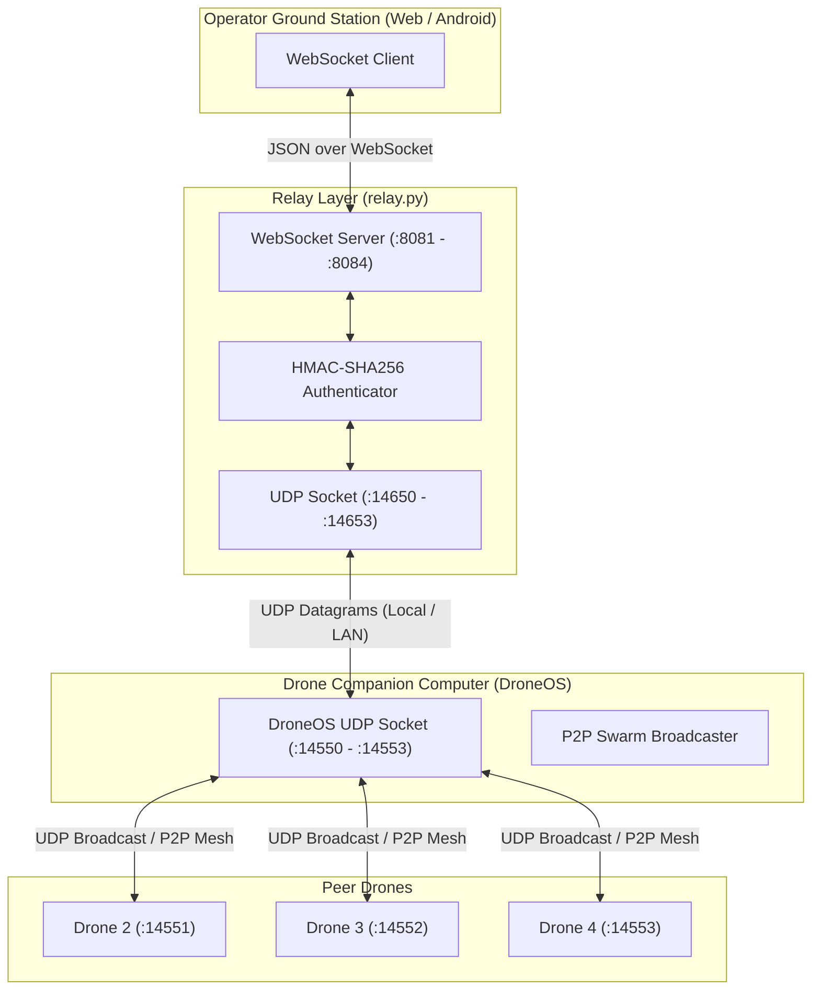

# Architecture: Communication & Network Protocols

## 1. Network Topology Overview

PhoneOS Swarm utilizes a hybrid network architecture designed to balance real-time control latency against browser/mobile compatibility:



---

## 2. Port Allocation Matrix

### 2.1 Simulation (Loopback Multi-Process Topology)
On a single developer PC, four drone instances run simultaneously. To avoid port conflicts, ports are strictly mapped:

| Drone Entity | DroneOS UDP Port | Relay UDP Bind Port | Relay WebSocket Port | AirSim RPC Port |
|---|---|---|---|---|
| **Drone 1** (`DroneOS1`) | `127.0.0.1:14550` | `127.0.0.1:14650` | `ws://0.0.0.0:8081` | `127.0.0.1:41451` |
| **Drone 2** (`DroneOS2`) | `127.0.0.1:14551` | `127.0.0.1:14651` | `ws://0.0.0.0:8082` | `127.0.0.1:41451` |
| **Drone 3** (`DroneOS3`) | `127.0.0.1:14552` | `127.0.0.1:14652` | `ws://0.0.0.0:8083` | `127.0.0.1:41451` |
| **Drone 4** (`DroneOS`)  | `127.0.0.1:14553` | `127.0.0.1:14653` | `ws://0.0.0.0:8084` | `127.0.0.1:41451` |

### 2.2 Production Hardware (Multi-Pi Dedicated LAN Topology)
In physical field deployment, each Raspberry Pi operates on its own dedicated IP:

| Entity | Hardware IP | DroneOS Port | Relay Port | MAVSDK Port | Serial Device |
|---|---|---|---|---|---|
| **Drone 1** | `192.168.1.101` | `14550` (UDP) | `8080` (WS) | `50051` (gRPC) | `/dev/serial0:115200` |
| **Drone 2** | `192.168.1.102` | `14550` (UDP) | `8080` (WS) | `50051` (gRPC) | `/dev/serial0:115200` |
| **Drone 3** | `192.168.1.103` | `14550` (UDP) | `8080` (WS) | `50051` (gRPC) | `/dev/serial0:115200` |
| **Drone 4** | `192.168.1.104` | `14550` (UDP) | `8080` (WS) | `50051` (gRPC) | `/dev/serial0:115200` |

---

## 3. The Relay Server (`relay/relay.py`)

The relay bridges browser/app clients to the asynchronous UDP network.

### 3.1 Security & Authentication
- **WebSocket Auth Token (`RELAY_AUTH_TOKEN`)**: If configured, the GCS must submit an authentication token during the initial connection handshake.
- **Network HMAC Signing (`DRONE_NET_SECRET`)**:
  - When enabled, all UDP packets include an `hmac_sig` field.
  - The relay signs commands before transmission to DroneOS and validates incoming telemetry signatures.
  - Packets with invalid or missing signatures are dropped with a warning log.

### 3.2 Dynamic & Static Route Forwarding
In simulation, `relay.py` accepts `--udp-target` mappings (e.g. `drone2=127.0.0.1:14551`). If a command specifies `target_id: "drone2"` while the pilot is connected to Relay 1 (`:8081`), the relay delivers the command directly to Drone 2's socket.

---

## 4. Message Schemas (`shared/protocol/messages.py`)

All network packets are serialized as UTF-8 JSON representations of Pydantic models.

### 4.1 Base Envelope (`BaseMessage`)
Every message extends `BaseMessage`:
```python
class BaseMessage(BaseModel):
    msg_type: MessageType          # Enum identifying packet type
    sender_id: str                 # e.g. "drone1", "gcs"
    timestamp: float               # Unix epoch float timestamp
    target_id: Optional[str]       # None for broadcast, or specific drone ID
    hmac_sig: Optional[str]        # Optional cryptographic signature
```

### 4.2 Control Message (`ControlMessage`)
Used to dispatch direct flight actions:
```python
class ControlMessage(BaseMessage):
    msg_type: MessageType = MessageType.CONTROL
    action: CommandAction          # Enum: ARM, TAKEOFF, LAND, RTL, HOVER, MOVE, FORMATION_UPDATE, GOTO, etc.
    params: Optional[Dict[str, Any]]
    cmd_id: Optional[str]          # Unique UUID for command lifecycle tracking
```

### 4.3 Command Lifecycle Message (`CommandLifecycleMessage`)
Provides feedback on command execution progress:
- Stages: `BACKEND_RECEIVED` $\rightarrow$ `SENDING` $\rightarrow$ `AIRSIM_DISPATCHED` $\rightarrow$ `ACCEPTED` / `REJECTED` / `FAILED`.

### 4.4 Telemetry Message (`TelemetryMessage`)
Emitted by each drone at 2–10 Hz:
```python
class TelemetryData(BaseModel):
    timestamp: float
    gps_valid: bool
    battery_level: float           # Percentage (0-100)
    voltage: float
    altitude: float                # Meters MSL or relative
    latitude: float
    longitude: float
    velocity_x: float              # North m/s
    velocity_y: float              # East m/s
    velocity_z: float              # Down m/s
    heading: float                 # Yaw in degrees
    pitch: float                   # Pitch in degrees
    roll: float                    # Roll in degrees
    flight_mode: str               # e.g. "OFFBOARD", "HOLD", "MISSION"
    armed_state: str               # "ARMED" or "DISARMED"
    mission_state: str             # "IDLE", "RUNNING", "PAUSED"
    future_intent: str             # Inter-drone collision avoidance intent
```

### 4.5 Peer Heartbeats (`HeartbeatMessage` & `SwarmHeartbeatMessage`)
Transmitted every `heartbeat_interval` (default: 1.0 s) between drones to maintain the `MembershipView`.

### 4.6 Perception & Detection Message (`DetectionMessage`)
Emitted by the perception subsystem when static aerial litter or targets are detected, geolocated, and temporally aggregated:
```python
class DetectionItem(BaseModel):
    id: str                        # Persistent track id, e.g. "drone1-g0001"
    label: str                     # Object classification label (e.g. "rubbish")
    confidence: float              # Maximum confidence [0.0, 1.0]
    lat: float                     # Georeferenced WGS84 latitude
    lon: float                     # Georeferenced WGS84 longitude
    hits: int                      # Observation count
    status: str                    # "new" or "update"
    altitude_agl: Optional[float]  # Drone height above ground at capture (m)

class DetectionMessage(BaseMessage):
    msg_type: MessageType = MessageType.DETECTION
    detections: List[DetectionItem] # Batch of aggregated detections (chunked <= 10)
    synthetic: bool = False         # True when produced by replay / image folder source
    frame_id: int = 0               # Sequential perception frame identifier
```
- **Relay Behavior**: Relayed to the mobile GCS WebSocket without requiring any relay modifications.
- **Peer Behavior**: Peers silently ignore incoming `DetectionMessage` packets unless subscribed.
- **Mobile GCS Handling**: Mobile `DroneContext` merges detections into a local reactive store (`PhoneOS_Garbage`), associating multi-drone observations within 2.0 m and displaying confidence-tinted markers on `MapView`.

