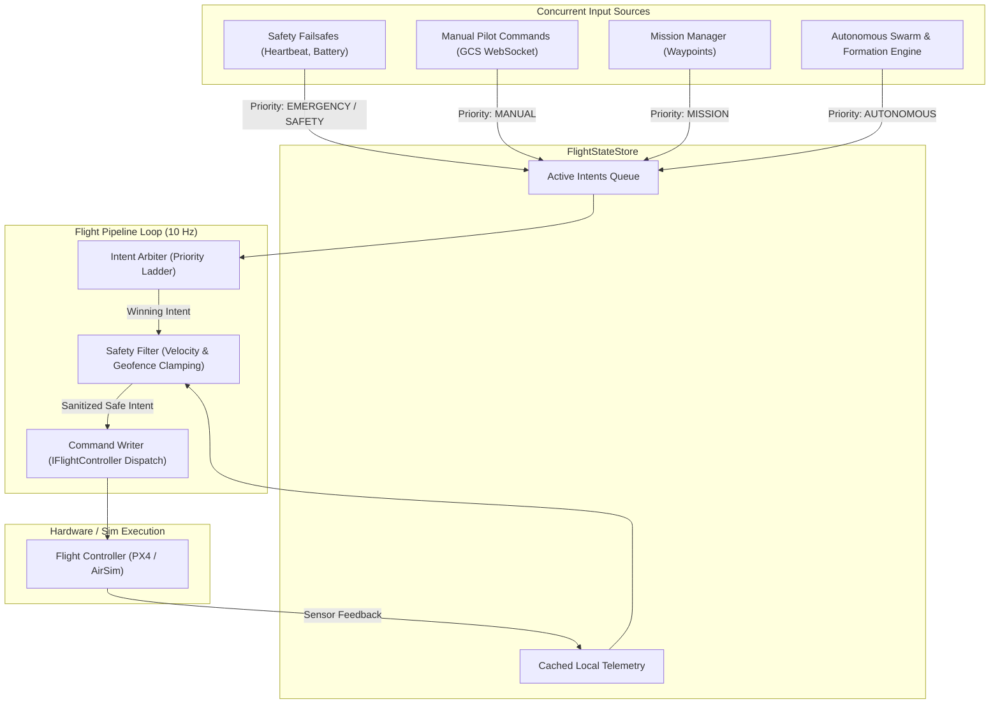
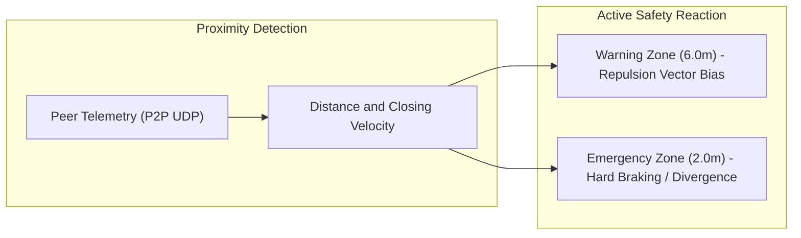

# Architecture: DroneOS Internals

## 1. Overview

`DroneOS` operates as an asynchronous, deterministic, safety-critical execution environment on each drone's companion computer. It guarantees that high-level autonomous plans never bypass flight safety envelopes, and that commands originating from multiple sources (manual pilot, autonomous formation engine, mission manager, safety failsafes) are arbitrated predictably.

---

## 2. Flight Pipeline & Intent Arbiter

At the heart of DroneOS is the **Flight Pipeline** (`core/flight_pipeline.py`), which runs at a deterministic rate (default: `10 Hz`).



### 2.1 The Intent Priority Ladder
When multiple commands arrive simultaneously, the `IntentArbiter` resolves conflicts based on strict hierarchy:

| Priority Rank | Intent Class | Source | Preempts Lower? | Example Action |
|---|---|---|---|---|
| **1 (Highest)** | `EMERGENCY` | Safety Module, Operator Panic | Yes, immediately | Immediate motor stop, forced emergency land |
| **2** | `SAFETY` | Failsafe Monitor (Low Battery, Link Loss) | Yes | Smart RTL, Auto-Land |
| **3** | `MANUAL` | Direct GCS Pilot Input | Yes | Joystick move, manual altitude nudge |
| **4** | `MISSION` | Waypoint Mission Engine | Yes | Autonomous route navigation |
| **5 (Lowest)** | `AUTONOMOUS` | Swarm Formation Engine / Repulsion | Overridden by any above | Target slot tracking, formation pacing |

### 2.2 Safety Filter
Before any intent reaches the `CommandWriter`, the `SafetyFilter` (`core/safety.py`) evaluates it:
- **Velocity Clamping:** Limits horizontal velocities to `max_velocity` (e.g. 5.0 m/s in hardware, 15.0 m/s in simulation) and vertical climb/sink rates.
- **Altitude Envelope:** Rejects downward velocity commands that would drive the aircraft below `ground_altitude_m` (default: 0.5 m).
- **Geofence Enforcement:** Prevents the vehicle from straying outside predefined boundary limits.

---

## 3. Flight Manager (`core/flight_manager.py`)

The `FlightManager` is the primary operational orchestrator for aircraft movement and state transitions.

### 3.1 Strict Arming & Takeoff Workflow
DroneOS enforces a strict separation between arming and takeoff to avoid accidental motor spooling:
1. **Arm Command:**
   - Triggers native pre-arm checks on the flight controller.
   - Verifies GPS lock and health checks.
   - Does **not** set flight mode to offboard until physical confirmation of the armed state is received over telemetry.
2. **Takeoff Command:**
   - Requires `is_armed == True`.
   - Transitions to guided/offboard mode and commands vertical climb to `takeoff_altitude` (default: 10.0 m).

### 3.2 Formation State Tracking
The `FlightManager` maintains the active `formation_params` dictionary:
```python
{
    "type": "V",                  # Formation shape (V, DIAMOND, COLUMN, etc.)
    "spacing": 15.0,              # Inter-drone distance in meters
    "slot_assignments": {         # Mapping from drone ID to integer slot
        "drone1": 0,
        "drone2": 1,
        "drone3": 2,
        "drone4": 3
    }
}
```
Whenever a `FORMATION_UPDATE` message is received, `FlightManager` computes the new target local position relative to the anchor (slot 0) and issues smooth translational velocity or position commands.

---

## 4. Navigation & Smart RTL (`core/navigation_manager.py` & `smart_rtl_engine.py`)

### Breadcrumb Navigation
During autonomous flight, the `SmartRTLEngine` records a historical path of 3D coordinates (breadcrumbs).
- If the drone triggers Return to Launch (RTL):
  - Instead of flying blindly in a straight line back to the home point (which might traverse newly formed obstacles or no-fly zones), it reverses its recorded breadcrumb trajectory.
  - Redundant breadcrumbs are pruned in real-time using Douglas-Peucker line simplification.

---

## 5. Collision Avoidance & Repulsion Field

DroneOS provides two complementary layers of inter-drone collision avoidance:



### 5.1 Dynamic Repulsion Field (`core/repulsion_field.py`)
- Each drone models neighboring peers as repulsive electrostatic-like potentials.
- When an adjacent drone penetrates the `warning_distance` (default: 6.0 m), a synthetic velocity vector pointing directly away from the intruder is superimposed onto the current flight vector:
  $$\vec{v}_{\text{repulsive}} = -k_{\text{rep}} \cdot \frac{\vec{p}_{\text{neighbor}} - \vec{p}_{\text{self}}}{\|\vec{p}_{\text{neighbor}} - \vec{p}_{\text{self}}\|^3}$$
- This guarantees smooth, natural divergence without sudden jerky maneuvers.

### 5.2 Hard Collision Avoidance (`core/collision_avoidance.py`)
- If distance drops below `emergency_distance` (default: 2.0 m), the avoidance module overrides the arbiter with emergency braking and altitude separation offsets.

---

## 6. Terminal Controller & Natural Language Processing (NLP)

DroneOS includes a natural language parser (`core/terminal_controller.py` and `shared/nlp/`) that accepts plain English commands from the GCS terminal and transforms them into flight trajectories.

### Examples of Supported NLP Commands
- **Basic Flight:** `"take off to 5 meters"`, `"hover for 10 seconds"`, `"land now"`.
- **Parametric Geometric Patterns:**
  - `"fly in a 10 meter radius circle at 5 meter altitude"`
  - `"do a 10 meter square search pattern at 3 meters"`
  - `"fly a figure eight size 5 at 3 meters"`
- **Relative Moves:** `"go 10 meters north and 5 meters east at 4 meters altitude"`.
- **Swarm Formations:**
  - `"formation V spacing 15m"`
  - `"form diamond spacing 20m"`
  - `"formation column spacing 12m"`
