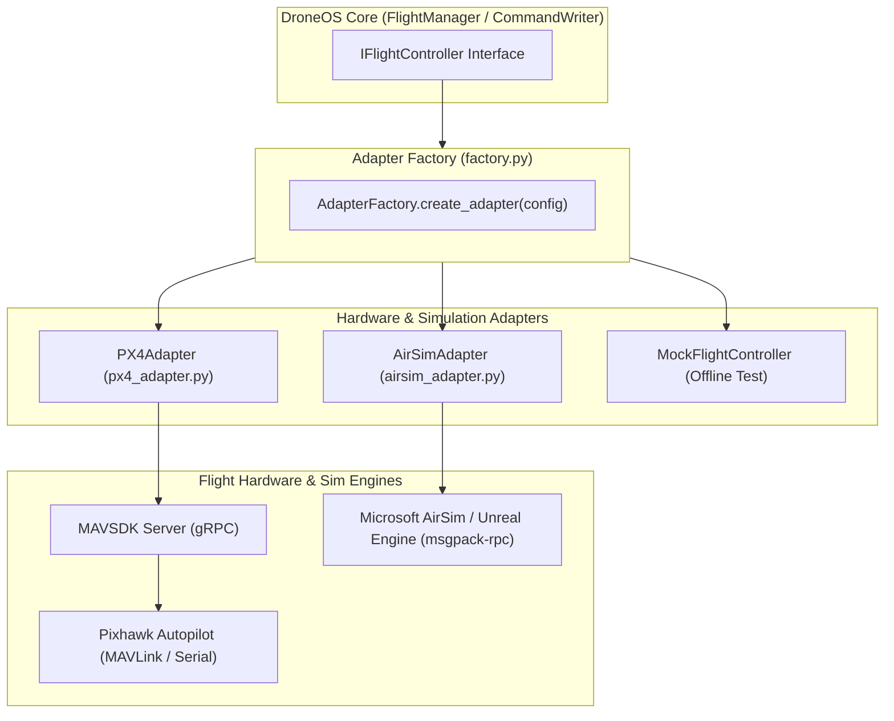

# Architecture: Flight Adapters & Hardware Abstraction

## 1. Overview

DroneOS abstracts low-level flight control hardware using the **Adapter Pattern**. By decoupling high-level swarm logic from specific flight controller protocols, DroneOS can execute identically against real Pixhawk hardware (via PX4/MAVSDK) or simulated multirotors in Unreal Engine (via Microsoft AirSim), or offline mocks during unit testing.



---

## 2. The `IFlightController` Interface (`core/interfaces.py`)

All adapters implement the standardized asynchronous interface `IFlightController`:

```python
class IFlightController(ABC):
    @abstractmethod
    async def connect(self) -> bool:
        """Establish connection with the underlying flight stack."""
        pass

    @abstractmethod
    async def disconnect(self) -> None:
        """Gracefully terminate connection."""
        pass

    @abstractmethod
    async def arm(self) -> bool:
        """Perform pre-arm safety verification and arm the motors."""
        pass

    @abstractmethod
    async def disarm(self) -> bool:
        """Disarm motors immediately."""
        pass

    @abstractmethod
    async def takeoff(self, altitude_m: float) -> bool:
        """Command takeoff to target altitude in meters."""
        pass

    @abstractmethod
    async def land(self) -> bool:
        """Command immediate autonomous landing."""
        pass

    @abstractmethod
    async def return_to_launch(self) -> bool:
        """Command aircraft to return to home coordinate."""
        pass

    @abstractmethod
    async def hover(self, force: bool = False) -> bool:
        """Hold current 3D position in space."""
        pass

    @abstractmethod
    async def move_velocity(self, vx: float, vy: float, vz: float, yaw_rate: float = 0.0) -> bool:
        """Stream continuous velocity setpoints in body/local NED frame."""
        pass

    @abstractmethod
    async def goto_local(self, x: float, y: float, z: float, yaw: float = 0.0) -> bool:
        """Command direct transit to local Cartesian NED coordinate."""
        pass

    @abstractmethod
    def subscribe_telemetry(self, callback: Callable[[TelemetryData], None]) -> None:
        """Register asynchronous callback for live sensor/attitude streaming."""
        pass
```

---

## 3. PX4 Adapter (`adapters/px4_adapter.py`)

The `PX4Adapter` integrates with real Pixhawk autopilots running PX4 firmware via `MAVSDK-Python`.

### 3.1 Architecture & gRPC Connection
- MAVSDK runs a embedded C++ backend daemon (`mavsdk_server`) that speaks raw MAVLink over UART serial (e.g. `/dev/serial0:115200` or `/dev/ttyACM0`).
- The Python adapter communicates with `mavsdk_server` over a fast, asynchronous gRPC channel (port `50051`).
- MAVSDK handles low-level MAVLink message parsing, heartbeat maintenance, and pre-arm check parsing.

### 3.2 Asynchronous Telemetry Streams
The adapter subscribes to MAVSDK telemetry streams:
- `drone.telemetry.position()` $\rightarrow$ Latitude, Longitude, Absolute Altitude.
- `drone.telemetry.battery()` $\rightarrow$ Battery Voltage and Remaining Percentage.
- `drone.telemetry.attitude_euler()` $\rightarrow$ Roll, Pitch, Yaw in degrees.
- `drone.telemetry.flight_mode()` $\rightarrow$ Current mode (HOLD, OFFBOARD, RETURN_TO_LAUNCH).
- `drone.telemetry.armed()` $\rightarrow$ Physical arm confirmation flag.

### 3.3 Safety Invariant
The `PX4Adapter` respects native Pixhawk safety interlocks. If Pixhawk reports pre-arm sensor failures (e.g. compass uncalibrated or lack of RTK/GPS lock), `arm()` fails gracefully and reports the error upstream.

---

## 4. AirSim Adapter (`adapters/airsim_adapter.py`)

The `AirSimAdapter` interfaces with Microsoft AirSim running inside Unreal Engine.

### 4.1 Communication & Kinematics
- Connects over TCP via `msgpack-rpc` on port `41451`.
- Targets vehicles by vehicle name (e.g. `vehicle_name: "Drone1"`, `"Drone2"`, etc.).
- Commands are issued via `airsim.MultirotorClient`:
  - `takeoffAsync(vehicle_name=...)`
  - `moveByVelocityAsync(vx, vy, vz, duration, vehicle_name=...)`
  - `moveToPositionAsync(x, y, z, velocity, vehicle_name=...)`

### 4.2 Coordinate System Transformations
- **AirSim Frame:** AirSim operates in a Cartesian NED (North-East-Down) frame where **$Z$ negative is Up**.
- **Geodetic Conversion:** Because the GCS and Swarm formation engine often use Global Geodetic (Lat/Lon/Alt), `AirSimAdapter` anchors a local geodetic origin at spawn:
  $$\Delta \text{Lat} = \frac{x_{\text{NED}}}{111319.5}, \quad \Delta \text{Lon} = \frac{y_{\text{NED}}}{111319.5 \cdot \cos(\text{Lat}_0)}$$
- This allows simulated aircraft to emit realistic global telemetry that matches physical Pixhawk outputs.

---

## 5. Adapter Factory (`adapters/factory.py`)

The active adapter is selected dynamically at startup based on `flight.yaml`:

```python
class AdapterFactory:
    @staticmethod
    def create_adapter(config: FlightConfig, vehicle_name: str) -> IFlightController:
        if config.adapter_type == "airsim":
            return AirSimAdapter(config.airsim_host, config.airsim_port, vehicle_name)
        elif config.adapter_type == "px4":
            return PX4Adapter(config.px4_connection_string)
        elif config.adapter_type == "mock":
            return MockFlightController()
        else:
            raise ValueError(f"Unknown adapter type: {config.adapter_type}")
```

