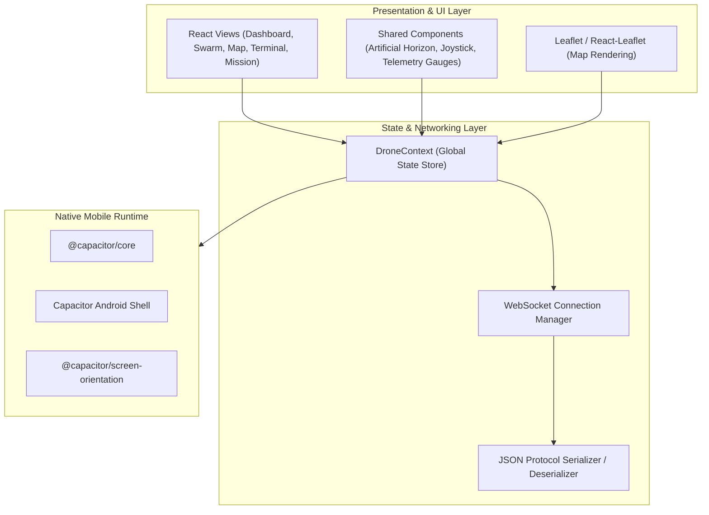

# Architecture: Ground Control Station (Mobile App)

## 1. Overview

The **PhoneOS Mobile GCS** (`mobile/`) is a responsive, cross-platform Ground Control Station built with **React 18**, **Vite**, and **Capacitor 6**. It provides real-time situational awareness, manual control, automated formation planning, and sensor diagnostics for multi-agent drone swarms. It can be run either as a web application in any modern browser or deployed as a native Android tablet application.

---

## 2. Technology Stack



- **Frontend Core:** React 18.3.1, JavaScript (ES modules), Vite 5.4.
- **Icons & Styling:** Lucide React, responsive CSS grid and flexbox.
- **Mapping:** Leaflet 1.9.4 and `react-leaflet` for OpenStreetMap waypoint and trajectory plotting.
- **Mobile Container:** Capacitor 6.2 (Native Android bridge, full-screen lock, asset bundling).

---

## 3. Multi-Drone State Management (`src/context/`)

The application maintains a concurrent state store for up to 4 drones:
- **`connections`**: Map of drone IDs (`drone1` - `drone4`) to WebSocket connection status (`CONNECTING`, `CONNECTED`, `DISCONNECTED`, `ERROR`).
- **`telemetry`**: Live telemetry objects received from each drone, updated at up to 10 Hz per vehicle:
  - Latitude, longitude, altitude, ground speed, velocities ($v_x, v_y, v_z$).
  - Pitch, roll, yaw (Euler angles).
  - Battery percentage, cell voltage, flight mode, armed status.
- **`activeFormation`**: Current global swarm formation state (type, spacing, assigned slots).
- **`commandHistory`**: Tracked command lifecycle stages (`BACKEND_RECEIVED`, `ACCEPTED`, `REJECTED`).

---

## 4. Key Application Views (`src/views/`)

| View | Component File | Description & Capabilities |
|---|---|---|
| **Swarm Control** | `SwarmView.jsx` | Swarm-wide formation orchestrator. Select formation shapes (V, Diamond, Column, Circle, Line, Square, Grid, Echelon), set inter-drone spacing (10–25m), preview 3D/2D offsets, and issue synchronized Takeoff, Arm, Land, and Hold. |
| **Multi-Dashboard** | `DashboardView.jsx` | Grid view displaying synchronized artificial horizon instruments, altitude ladders, compass roses, and battery gauges for all 4 drones simultaneously. |
| **Tactical Map** | `MapView.jsx` | Real-time geospatial overview. Displays drone positions, planned flight corridors, formation bounding polygons, home points, and breadcrumb tracks on OpenStreetMap tiles. |
| **NLP Terminal** | `TerminalView.jsx` | Interactive command console accepting plain English text commands (e.g. `"formation V spacing 15m"`, `"climb 5m"`), showing immediate parsing feedback and execution status. |
| **Mission Planner** | `MissionView.jsx` | Waypoint route creation, altitude profiling, mission upload, pause, resume, and progress tracking. |
| **Diagnostics & Health**| `DiagnosticsView.jsx`, `SystemHealthView.jsx` | Low-level subsystem status, sensor health flags (gyro, accel, mag), GPS fix quality, and packet drop counters. |
| **Sensor Calibration** | `SensorCalibrationView.jsx` | Interactive wizard guiding technicians through Pixhawk accelerometer, compass, and gyro calibration procedures. |
| **Settings & Relays** | `SettingsView.jsx` | Configuration of IP addresses and WebSocket ports for each drone's network relay. |

---

## 5. Live Artificial Horizon (`src/components/ArtificialHorizon.jsx`)

The mobile GCS renders high-fidelity, hardware-accelerated artificial horizon instruments:
- Reads `pitch` and `roll` from the incoming `TelemetryData` stream.
- Rotates the horizon ball and pitch ladders using CSS 3D transforms.
- Updates smoothly at 60 FPS without impacting map rendering performance.

---

## 6. Android Build & Deployment Pipeline

The application can be compiled directly into a native Android APK:

```bash
# 1. Install dependencies
cd mobile
npm install

# 2. Build Vite production bundle
npm run build

# 3. Synchronize Capacitor assets to Android project
npx cap sync android

# 4. Compile Debug APK via Gradle
cd android
./gradlew assembleDebug
```

The compiled APK will be generated at:
`mobile/android/app/build/outputs/apk/debug/app-debug.apk`

