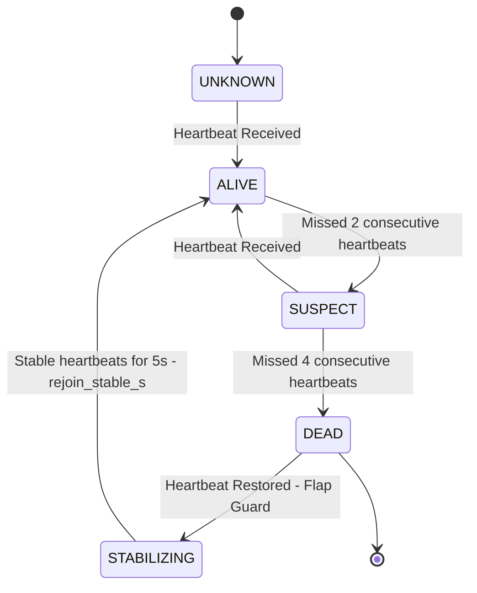
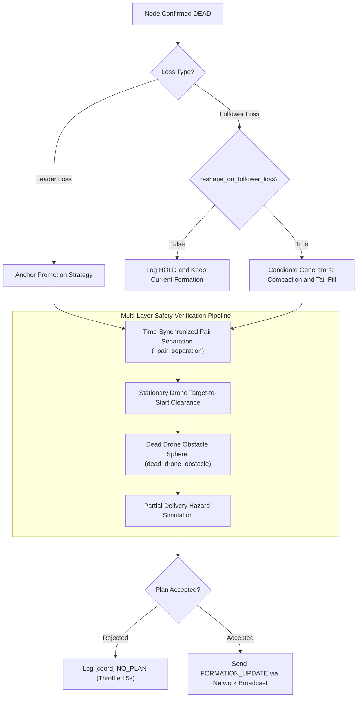

# Architecture: Swarm Coordination & Self-Healing

## 1. Overview

The PhoneOS Swarm coordination subsystem enables decentralized, fault-tolerant multi-agent operations. When an aircraft suffers motor failure, software crash, battery exhaustion, or communication loss, the surviving drones reach consensus, elect an anchor, replan the formation geometry, and heal the swarm autonomously in mid-air.

---

## 2. Peer State Lifecycle & Membership (`core/coordination/membership.py`)

Each drone maintains a local `MembershipView` tracking every node in the swarm:

### 2.1 State Definitions
- **`UNKNOWN`**: Node not yet heard from.
- **`ALIVE`**: Node is actively transmitting heartbeats and telemetry within acceptable latency limits (`< 1.0 s`).
- **`SUSPECT`**: Missed `suspect_missed_beats` (default: 2). Triggers alert logging but does not initiate reshape.
- **`DEAD`**: Missed `dead_missed_beats` (default: 4). Node is confirmed lost; triggers self-healing pipeline.
- **Flapping Protection (`STABILIZING`)**: A node marked `DEAD` that intermittently emits a single heartbeat cannot immediately rejoin. It must emit steady heartbeats for `rejoin_stable_s` (default: 5.0 s) before being transitioned back to `ALIVE`.

---

## 3. Consensus & Quorum Engine (`core/coordination/quorum.py`)

To prevent split-brain execution when network partitions occur:
- The swarm calculates quorum against the total expected cluster size $N$ (e.g. 4 drones).
- **Quorum Rule:** A healing plan or anchor election is only legitimate if the number of healthy surviving nodes $S$ satisfies:
  $$S \ge \left\lfloor \frac{N}{2} \right\rfloor + 1$$
- For a 4-drone swarm:
  - 4 survivors $\rightarrow$ `QUORUM` (100%)
  - 3 survivors $\rightarrow$ `QUORUM` (75%)
  - 2 survivors $\rightarrow$ `SPLIT_BRAIN_HAZARD` / `NO_QUORUM` (Self-healing blocked; aircraft hold position or RTL).

---

## 4. Anchor Election & Promotion (`core/coordination/anchor.py`)

The **Anchor** (Slot 0) serves as the spatial reference origin for all formation offsets. If the anchor drone fails or runs critically low on battery, the survivors elect a new anchor:

### Election Criteria Ladder
1. **Health State:** Must be confirmed `ALIVE` and `gps_valid == True`.
2. **Battery Floor:** Battery percentage must exceed `anchor_min_battery` (default: 30%).
3. **Anchor Dwell Time:** An incumbent anchor must dwell for at least `anchor_min_dwell_s` (default: 5.0 s) to prevent rapid anchor ping-pong.
4. **Deterministic Tie-Breaker:** When multiple candidates qualify, the candidate with the lowest lexicographical node ID (e.g. `"drone1"` before `"drone2"`) is chosen.

---

## 5. Formation Engine (`core/formation_engine.py`)

The `FormationEngine` computes 3D local NED offsets $(x, y, z)$ relative to the anchor's slot 0 for $K$ drones with inter-drone spacing $S$:

| Formation Shape | Coordinate Offset Formula $\Delta (x, y)$ for Slot $i \in [0, K-1]$ | Physical Layout |
|---|---|---|
| **`V` (Wedge)** | Left wing (even $i$): $(-d \cdot \sin 30^\circ, -d \cdot \cos 30^\circ)$ Right wing (odd $i$): $(-d \cdot \sin 30^\circ, +d \cdot \cos 30^\circ)$ | Classic aeronautical chevron |
| **`DIAMOND`** | Top $(0, 0)$, Left $(-S, -S)$, Right $(-S, +S)$, Bottom $(-2S, 0)$ | Tactical diamond patrol |
| **`COLUMN`** | $(-i \cdot S, 0)$ | Single-file trail convoy |
| **`LINE`** | $(0, (-1)^i \cdot \lceil i/2 \rceil \cdot S)$ | Broad abreast sweep |
| **`CIRCLE`** | $R = \frac{S}{2 \sin(\pi / K)}$, $\theta_i = \frac{2\pi i}{K}$; $(\Delta x, \Delta y) = (R \cos \theta_i - R, R \sin \theta_i)$ | Surveillance orbit perimeter |
| **`ECHELON_LEFT`** | $(-i \cdot S \cos 45^\circ, -i \cdot S \sin 45^\circ)$ | Diagonal left sweep |
| **`ECHELON_RIGHT`**| $(-i \cdot S \cos 45^\circ, +i \cdot S \sin 45^\circ)$ | Diagonal right sweep |
| **`GRID` / `SQUARE`**| Row $r = \lfloor i / C \rfloor$, Col $c = i \bmod C$; $(\Delta x, \Delta y) = (-r \cdot S, c \cdot S)$ | Search-and-rescue matrix |

---

## 6. Self-Healing Engine (`core/coordination/healing.py`)

When a member is confirmed `DEAD`, the surviving anchor invokes `plan_healing()`.

### 6.1 Follower Reshape vs. Leader Loss
- **Leader Loss:** Slot 0 died. A survivor must be promoted to slot 0 and take over origin coordinates.
- **Follower Loss:** A non-anchor drone died. When `reshape_on_follower_loss: true`, the formation contracts from $N$ to $N-1$ slots to close the hole.

### 6.2 Candidate Generation Strategies
1. **`compaction`**: Drones in higher slot numbers shift downward to occupy the vacated slot in sequence (e.g., in a 4-drone convoy where slot 1 dies: slot 2 moves to 1, slot 3 moves to 2).
2. **`tail_fill`**: Only the drone in the highest tail slot moves forward to fill the vacant hole, minimizing total swarm energy expenditure.
3. **`anchor_promotion`**: Elects the highest-priority survivor to slot 0 and re-indexes remaining survivors.

### 6.3 Plan Safety Verification
Every candidate assignment is evaluated against physical safety constraints before issuance:

1. **Time-Synchronized Pair Separation (`_pair_separation`)**:
   - In convoy compaction (e.g. `COLUMN`, `ECHELON`), multiple drones translate along the same line corridor simultaneously ($s_1 = e_2$).
   - A static segment check would falsely report $0.00\text{ m}$ distance.
   - `_pair_separation` computes dynamic separation over normalized time $t \in [0, 1]$ for co-directional flights:
     $$\Delta \vec{p}(t) = (\vec{s}_1 - \vec{s}_2) + t \cdot (\vec{v}_1 - \vec{v}_2)$$
     verifying distance never drops below `min_required_sep`.
2. **Stationary Hover Clearance**:
   - Protects hovering aircraft from drones taking off or transiting directly over them (`is_hovering` guard).
3. **Dead Drone Obstacle Sphere**:
   - The last known position of the dead aircraft is treated as a 3D physical obstacle with radius `dead_obstacle_radius_m` (default: 6.0 m). No survivor flight path may intersect this sphere.
4. **Settle Gates & Rate Limiting**:
   - Re-slot cooldown: `reslot_cooldown_s` (5.0 s).
   - Session cap: `max_heals_per_session` (3 heals max per battery cycle to prevent oscillation).
   - Settle gate tracks formation type, spacing, and slot assignments, preventing premature heals during active transit.
