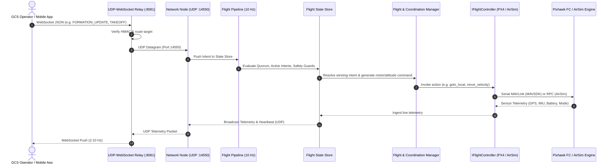

# Architecture: System Overview

## 1. Executive Summary

PhoneOS Swarm is a distributed, modular drone operating system engineered to govern multi-agent swarms (tested natively up to 4 autonomous aircraft). It decouples high-level autonomous behaviors—such as formation flight, peer consensus, trajectory replanning, dynamic obstacle avoidance, and self-healing—from low-level flight stabilization and motor control.

The system is built to run on **companion computers** (e.g., Raspberry Pi 4/5) physically mounted to each drone, communicating with flight hardware (Pixhawk running PX4) via high-speed serial MAVLink, or with simulated aircraft (Microsoft AirSim / Unreal Engine) via RPC.

---

## 2. Four-Node Mirrored Package Topology

A cornerstone architectural pattern in this repository is the **Four-Node Mirrored Package Structure**:

```
PhoneOS_Swarm/
├── DroneOS/     # Base core package (and instance for Drone 4)
├── DroneOS1/    # Mirrored package for Drone 1
├── DroneOS2/    # Mirrored package for Drone 2
└── DroneOS3/    # Mirrored package for Drone 3
```

### Why Mirrored Packages?
In real-world deployment, each physical drone runs its own operating system instance independently on its onboard companion computer. However, during local simulation, integration testing, and software-in-the-loop (SITL) execution, four separate drone processes run concurrently on a single developer workstation.

To prevent Python module cache collisions (`sys.modules`), shared global state, and race conditions between threads/event loops across different drones in the same process tree:
1. Each instance is packaged as an independent top-level Python namespace (`DroneOS`, `DroneOS1`, `DroneOS2`, `DroneOS3`).
2. **Strict Isolation Rule:** `DroneOS1`, `DroneOS2`, and `DroneOS3` must **never** import from `DroneOS.*`. They only import from their own namespace (e.g. `from DroneOS1.core...`).
3. Each instance has its own configuration directory (`configs/`), state store, event loop, and UDP ports.
4. Changes to core logic are mirrored across all four instances using automated scripts or direct parity checks.

---

## 3. End-to-End System Dataflow



---

## 4. Key Subsystems Breakdown

### 4.1 Ground Control Station (GCS)
- **Implementation:** React 18, Vite, Lucide icons, Leaflet maps, and Capacitor 6.
- **Role:** Presents unified real-time multi-drone situational awareness:
  - Live artificial horizons for all 4 drones simultaneously.
  - Interactive map with dynamic waypoint plotting and GPS tracks.
  - Formation selector (V, Diamond, Column, Circle, Line, Square, Grid, Echelon).
  - Natural Language Processing (NLP) terminal for voice/text commands.
  - Sensor calibration, motor testing, and parameter configuration screens.

### 4.2 Network Relay Layer (`relay/relay.py`)
- **Role:** Sits between the web-friendly WebSocket world of the GCS and the high-throughput, low-latency UDP broadcast/mesh world of the drones.
- **Capabilities:**
  - Manages WebSocket client connections on individual ports (`8081`-`8084`).
  - Converts incoming JSON commands into signed UDP packets.
  - Optionally signs and verifies packets with HMAC-SHA256 (`DRONE_NET_SECRET`).
  - Supports loopback routing tables in simulation, allowing the pilot to issue swarm commands through any connected relay.

### 4.3 DroneOS Companion Core
- **Role:** Autonomous brain running on the companion computer.
- **Core Modules:**
  - `FlightPipeline`: 10 Hz deterministic control loop with intent arbitration.
  - `SafetyModule`: Enforces battery limits, velocity clamping, and heartbeat failsafes.
  - `CoordinationManager`: Handles peer discovery, quorum evaluation, anchor election, and autonomous self-healing.
  - `FormationEngine`: Calculates mathematical slot offsets for various geometric formations.
  - `DecisionEngine` & `RepulsionField`: Real-time proximity calculation and dynamic avoidance vectors.
  - `MissionManager`: Multi-waypoint autonomous mission progression.

### 4.4 Hardware Abstraction Layer (HAL)
- **Role:** Standardizes the API between the high-level OS and various physical or simulated flight controllers via `IFlightController`.
- **Implementations:**
  - `PX4Adapter`: Uses MAVSDK-Python to communicate over serial (`/dev/serial0` or `/dev/ttyACM0`) with Pixhawk autopilots.
  - `AirSimAdapter`: Communicates over TCP RPC with Microsoft AirSim in Unreal Engine.

---

## 5. Execution Modes & Profiles

The system's behavior is parameterized by the `DRONEOS_PROFILE` environment variable:

| Profile | Target Environment | Flight Controller | Coordination Mode | Reshape on Follower Loss |
|---|---|---|---|---|
| **`prod` / unset** | Real Hardware (Raspberry Pi + Pixhawk) | PX4 (Serial MAVSDK) | Hardware configured | Per `flight.yaml` |
| **`sim`** | AirSim Simulation | AirSim (msgpack-rpc) | Active (`flight.sim.yaml`) | Enabled |
| **`test`** | Automated Regression / Integration Tests | AirSim / Mock | Active + Armed (`flight.test.yaml`) | Enabled |

When `DRONEOS_PROFILE` is set, `resolve_flight_config()` dynamically merges `configs/flight.<profile>.yaml` on top of `configs/flight.yaml`, ensuring clean separation between test, simulation, and flight profiles.
