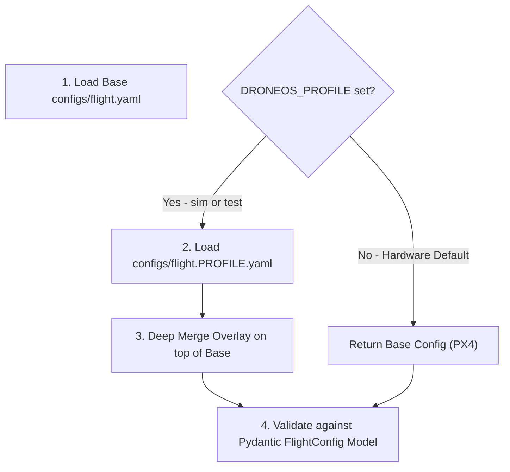

# Guide: Configuration Reference

## 1. Overview

DroneOS uses structured **YAML** files located in each instance's `configs/` directory. Configuration files are strongly typed and validated at runtime using **Pydantic** models defined in `shared/config/models.py`.

---

## 2. Profile Resolution System (`shared/config/profile.py`)

DroneOS supports multiple deployment profiles via the `DRONEOS_PROFILE` environment variable:



### Profile Values:
- **Unset or `prod`:** Production hardware profile. Uses `flight.yaml` (PX4 adapter via serial).
- **`sim`:** Simulation profile. Overlays `flight.sim.yaml` (AirSim adapter, loopback networking, follower loss reshape enabled).
- **`test`:** Test runner profile. Overlays `flight.test.yaml` (AirSim / Mock adapter, active coordination + armed).

---

## 3. Flight Configuration (`flight.yaml`, `flight.sim.yaml`, `flight.test.yaml`)

```yaml
adapter_type: "px4"                    # "px4", "airsim", or "mock"
takeoff_altitude: 10.0                 # Default takeoff height in meters
max_velocity: 5.0                      # Max horizontal velocity clamp (m/s)
pipeline_hz: 10.0                      # Control loop execution frequency (Hz)
px4_connection_string: "serial:///dev/serial0:115200" # MAVLink UART connection
airsim_host: "127.0.0.1"               # AirSim RPC host IP
airsim_port: 41451                     # AirSim RPC port

# Inter-Drone Dynamic Collision Avoidance
collision_avoidance:
  enabled: true                        # Enable proximity detection & repulsion
  min_horizontal_distance: 4.0         # Hard minimum horizontal safety buffer (m)
  min_vertical_distance: 2.0           # Hard minimum vertical safety buffer (m)
  warning_distance: 6.0                # Distance where repulsion field engages (m)
  emergency_distance: 2.0              # Distance triggering hard avoidance braking (m)
  neighbor_timeout_sec: 3.0            # Max age of peer telemetry before discarding
  lookahead_sec: 3.0                   # Velocity projection lookahead window (s)
  avoidance_speed: 5.0                 # Normal avoidance divergence velocity (m/s)
  emergency_speed: 8.0                 # Emergency evasive maneuver velocity (m/s)
  max_peer_age_sec: 2.5                # Peer position validity timeout (s)
  ground_altitude_m: 0.5               # Minimum floor altitude clamp (m)

# Swarm Formation Settings
formation:
  spacing: 15.0                        # Default inter-drone spacing (m)
  velocity_gain: 1.0                   # Proportional gain for slot tracking
  min_formation_separation_m: 3.0      # Safety floor for formation generator

# Decentralized Coordination & Self-Healing
coordination:
  enabled: true                        # Enable coordination manager
  mode: "active"                       # "active" (executes heals) or "advisory" (log-only)
  armed: true                          # Arm self-healing execution
  heartbeat_interval: 1.0              # Swarm heartbeat interval (s)
  suspect_missed_beats: 2              # Missed beats before peer is marked SUSPECT
  dead_missed_beats: 4                 # Missed beats before peer is confirmed DEAD
  rejoin_stable_s: 5.0                 # Required stable heartbeat window to rejoin (s)
  anchor_min_battery: 30               # Minimum battery % required to serve as anchor
  anchor_min_dwell_s: 5.0              # Minimum dwell time before anchor re-election (s)
  heal_max_position_age_s: 5.0         # Maximum age of peer position allowed for healing
  heal_settled_radius_m: 6.0           # Radius around slot to consider aircraft settled
  quorum_required: true                # Require quorum consensus to heal
  reslot_cooldown_s: 5.0               # Minimum cooldown between successive heals (s)
  reshape_on_follower_loss: true       # Reconstitute formation when a follower drone dies
  dead_drone_obstacle: true            # Treat dead drone coordinates as physical obstacles
  dead_obstacle_radius_m: 6.0          # Obstacle exclusion radius around dead aircraft (m)
  max_heals_per_session: 3             # Maximum number of automated mid-air heals per flight
  kill_switch_file: "COORD_DISABLE"    # Local file to instantly disable coordination

# Simulation Overrides
sim:
  battery_drain_multiplier: 0.0        # Disable battery drain in simulation
  drop_gps: false                      # Inject synthetic GPS dropouts
```

---

## 4. Network Configuration (`network.yaml`, `network.sim.yaml`)

Defines socket bindings and mesh routing topology:

```yaml
# Hardware LAN Configuration (network.yaml)
host: "0.0.0.0"                        # Bind address for incoming UDP traffic
port: 14550                            # Local UDP port for this drone
broadcast_address: "255.255.255.255"   # LAN broadcast address for peer discovery
heartbeat_interval: 1.0                # Interval for emitting peer heartbeats (s)
telemetry_interval: 0.5                # Interval for emitting telemetry packets (s)
connection_timeout: 10.0               # Peer link drop timeout (s)

# Simulation Loopback Configuration (network.sim.yaml)
host: "127.0.0.1"                      # Loopback address
port: 14550                            # Port unique to Drone 1
broadcast_address: "127.0.0.1"
peer_endpoints:                        # Deterministic loopback peer routing table
  - ["127.0.0.1", 14650]               # Drone 1 relay input
  - ["127.0.0.1", 14551]               # Drone 2
  - ["127.0.0.1", 14552]               # Drone 3
  - ["127.0.0.1", 14553]               # Drone 4
```

---

## 5. Safety Configuration (`safety.yaml`)

Enforces hardware failsafes managed by `sensors/health_monitor.py` and `core/safety.py`:

```yaml
low_battery_threshold: 20.0            # Battery % triggering LOW_BATTERY warning
critical_battery_threshold: 10.0       # Battery % triggering autonomous Land / RTL
heartbeat_timeout: 5.0                 # Loss of GCS heartbeat triggering failsafe
```

---

## 6. Identity Configuration (`drone.yaml`)

Unique identifier for the drone instance:

```yaml
drone_id: "drone1"                     # Unique swarm identifier ("drone1" - "drone4")
vehicle_name: "Drone1"                 # Target vehicle name in AirSim / MAVLink
```
