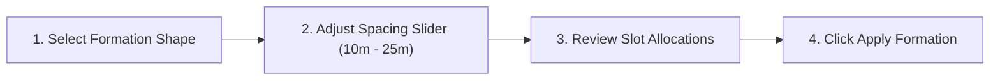

# Guide: Ground Control Station (GCS) User Guide

## 1. Overview

The PhoneOS Ground Control Station (GCS) provides a unified command center for operating single aircraft or multi-drone swarms. It can be accessed through a web browser or deployed to an Android tablet.

---

## 2. Connecting to the Swarm

1. Open the GCS application.
2. Click the **Settings** gear icon in the navigation bar.
3. Under **Multi-Drone Connections**, enter the host IP and WebSocket port for each aircraft in your swarm:
   - **Simulation Mode:** Connect to `ws://127.0.0.1:8081`, `:8082`, `:8083`, `:8084`.
   - **Field / Hardware Mode:** Connect to the static LAN IP of each companion computer on port `8080` (e.g. `ws://192.168.1.101:8080`).
4. Once entered, the status badge turns **GREEN** (`CONNECTED`).

---

## 3. Operating Formations in Swarm View

The **Swarm View** (`SwarmView.jsx`) is the primary interface for coordinating multi-drone flights:



### 3.1 Formation Workflow:
1. **Takeoff First:** Ensure all aircraft are armed and hovering at safe takeoff altitude ($\ge 10\text{ m}$).
2. **Choose Shape:** Select from the interactive shape grid:
   - `V` (Chevron)
   - `DIAMOND`
   - `COLUMN`
   - `LINE`
   - `CIRCLE`
   - `SQUARE` / `GRID`
   - `ECHELON_LEFT` / `ECHELON_RIGHT`
3. **Set Inter-Drone Spacing:**
   - Use the slider to set spacing.
   - Recommended field default: `15.0 m`.
   - Minimum supported spacing: `10.0 m` (enforced by software collision avoidance guards).
4. **Dispatch Formation:**
   - Tap **Apply Formation**. A `FORMATION_UPDATE` message is dispatched across the swarm network.
   - The aircraft will compute their relative coordinates and translate into position.

---

## 4. Multi-Drone Dashboard & Artificial Horizon

The **Dashboard View** provides live flight instrumentation for all 4 drones side-by-side:

- **Artificial Horizon:** 60 FPS CSS 3D pitch and roll indicators displaying real-time aircraft attitude.
- **Altitude Ladder:** Digital and graphic altitude readouts with climb/sink velocity indicators ($v_z$).
- **Compass Rose:** Heading visualization showing magnetic/true yaw angles.
- **Battery Status:** Percentage and cell voltage meters with color-coded warning thresholds:
  - Green: $> 30\%$
  - Amber (Low): $\le 20\%$ (Triggers advisory warnings)
  - Red (Critical): $\le 10\%$ (Triggers automated Failsafe Land or RTL)

---

## 5. Natural Language Processing (NLP) Terminal

The **Terminal View** allows pilots to issue natural language flight commands:

### 5.1 Natural English Examples
- `"take off to 5 meters"`
- `"climb 2 meters"`
- `"move 10 meters north and 5 meters east"`
- `"fly in a 10 meter radius circle at 5 meter altitude"`
- `"do a 10 meter square search pattern at 3 meters"`
- `"formation V spacing 15m"`
- `"form diamond spacing 20m"`
- `"hold position"`
- `"return to launch"`
- `"land now"`

### 5.2 Compact CLI Forms
For rapid operator input during field tests:
```text
takeoff h=5
circle r=10 h=5
square size=10 h=3
goto x=10 y=5 h=3
climb 2
descend 1
hold
rtl
land
```

---

## 6. Sensor Calibration & Pre-Flight Checks

Before outdoor flight, ensure sensors are properly calibrated using **Sensor Calibration View**:

1. **Accelerometer Calibration:**
   - Place drone on level ground, click **Calibrate Accelerometer**.
   - Follow prompts to orient drone on its back, left, right, nose up, nose down.
2. **Compass Calibration:**
   - Click **Calibrate Compass**.
   - Slowly rotate aircraft $360^\circ$ through all three spatial axes away from large metallic structures.
3. **Gyro Calibration:**
   - Ensure the drone is completely stationary, click **Calibrate Gyro**. Takes $\sim 5$ seconds.
