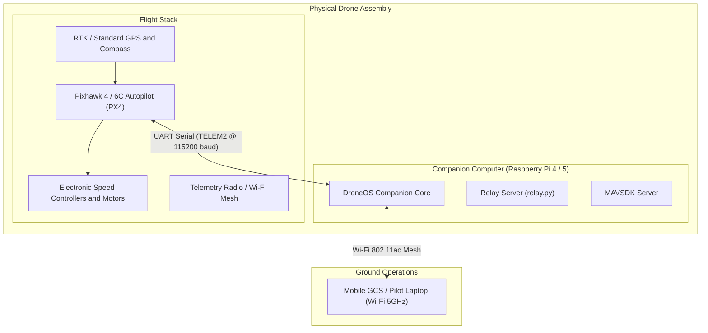

# Guide: Hardware Deployment & Field Operations

## 1. Physical Hardware Architecture

In real-world operations, each drone in the swarm is equipped with an independent companion computer executing an instance of DroneOS.



---

## 2. Wiring & Serial Configuration

### 2.1 Pixhawk to Raspberry Pi Connection
- Connect the Pixhawk's **TELEM2** port to the Raspberry Pi's GPIO UART pins or via a FTDI USB-to-Serial converter.
  - **Pin Connections (GPIO UART):**
    - Pixhawk TX $\rightarrow$ Pi RX (GPIO 15 / Pin 10)
    - Pixhawk RX $\rightarrow$ Pi TX (GPIO 14 / Pin 8)
    - Pixhawk GND $\rightarrow$ Pi GND (Pin 6)
- Alternatively, connect Pixhawk's micro-USB/USB-C port directly to a Raspberry Pi USB 3.0 port (`/dev/ttyACM0`).

### 2.2 Serial Port Resolution (`resolve_serial`)
DroneOS includes an automatic serial discovery helper (`resolve_serial`) in `start_drone*.py`:
- Scans `/dev/serial/by-id/*`, `/dev/ttyACM*`, `/dev/ttyUSB*`, and `/dev/ttyAMA*`.
- Configured via `px4_connection_string` in `configs/flight.yaml`:
  ```yaml
  px4_connection_string: "serial:///dev/serial0:115200"
  ```

### 2.3 Raspberry Pi Serial Permissions
Ensure the `pi` user has access to serial dialout groups:
```bash
sudo usermod -a -G dialout pi
sudo systemctl stop serial-getty@ttyAMA0.service
sudo systemctl disable serial-getty@ttyAMA0.service
```

---

## 3. Provisioning the Raspberry Pi

### 3.1 Base Operating System
- **Recommended OS:** Raspberry Pi OS Lite (64-bit) Debian Bookworm or Bullseye.
- Set a static IP on your field router for each drone (e.g., Drone 1: `192.168.1.101`, Drone 2: `192.168.1.102`, etc.).

### 3.2 Cloning and Virtual Environment Setup
```bash
cd /home/pi
mkdir -p Projects
cd Projects
git clone https://github.com/Debanshu2005/DroneSwarm.git PhoneOS
cd PhoneOS

# Set up virtual environment
python3 -m venv venv
source venv/bin/activate
pip install --upgrade pip
pip install -r DroneOS1/requirements.txt   # (or relevant drone instance)
pip install mavsdk grpcio psutil websockets pyyaml pydantic
```

---

## 4. Systemd Autostart Service Installation

PhoneOS Swarm includes pre-configured systemd service units in `deploy/`.

### 4.1 Installing the Service
To configure a drone to automatically boot DroneOS and the network relay on system startup, run `deploy/install.sh` followed by the drone index ($1$ to $4$):

```bash
# On Drone 1:
./deploy/install.sh 1

# On Drone 2:
./deploy/install.sh 2
```

### 4.2 What `install.sh` Does:
1. Copies `deploy/phoneos-drone<N>.service` to `/etc/systemd/system/`.
2. Sets strict file permissions (`644`).
3. Reloads the systemd daemon (`systemctl daemon-reload`).
4. Enables the service to start automatically on system boot.
5. Immediately starts the service.

### 4.3 Service Resource Constraints
To prevent runaway memory or CPU usage from freezing the Raspberry Pi and locking out SSH sessions, each service unit enforces strict cgroups limits:
```ini
[Service]
CPUQuota=70%
MemoryMax=1500M
MemoryHigh=1200M
IOWeight=50
OOMScoreAdjust=500
Nice=5
Restart=on-failure
RestartSec=5s
```

---

## 5. Monitoring & Field Troubleshooting

### 5.1 Checking Live Service Status
```bash
systemctl status phoneos-drone1
```

### 5.2 Streaming Real-Time Journal Logs
```bash
journalctl -u phoneos-drone1 -f
```

### 5.3 Manual Restart or Stop
```bash
sudo systemctl restart phoneos-drone1
sudo systemctl stop phoneos-drone1
```

---

## 6. Pre-Flight Field Checklist

> [!CAUTION]
> **SAFETY FIRST:** Always remove all propellers during indoor, bench, and networking tests. Only mount propellers immediately before outdoor flight.

1. **Power Sequence:**
   - Power up the Wi-Fi field base station / router.
   - Power up the Raspberry Pi companion computers.
   - Connect main LiPo batteries to Pixhawk power modules.
2. **Connectivity Verification:**
   - From the pilot laptop/tablet, ping all drone IPs (`192.168.1.101` - `104`).
   - Launch Mobile GCS and confirm green status badges on all 4 WebSocket connections.
3. **Sensor Calibration & GPS Fix:**
   - Open **Diagnostics View** on the GCS.
   - Verify `gps_valid: true`, visible satellites $\ge 12$, and HDOP $\le 1.2$.
   - Confirm IMU and compass health indicators are green.
4. **Arming Check:**
   - Step back to a safe standoff distance ($\ge 10\text{ m}$).
   - Issue Arm command via GCS. Confirm visual arming indications on the airframe LEDs.
5. **Takeoff & Assembly:**
   - Issue Takeoff command. Aircraft will climb vertically to `takeoff_altitude` (10m) and hold position.
   - Select desired formation (`V`, `DIAMOND`, etc.) with minimum spacing $\ge 12\text{ m}$.
