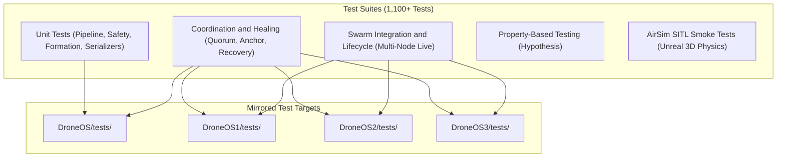

# Handoff: Testing & Verification Guide

## 1. Test Suite Architecture

PhoneOS Swarm features an exhaustive testing framework designed to validate every layer of the operating system—from mathematical formation offsets to network protocol serialization, failsafe triggers, and multi-agent mid-air self-healing.



---

## 2. Test Execution Commands

### 2.1 Complete Base Test Suite
Run the full test suite for `DroneOS` (1,119 tests):

```bash
python -m pytest DroneOS/tests -q
```
*Note: Tests marked `@pytest.mark.integration` or requiring live AirSim instances are automatically skipped when running offline.*

### 2.2 Coordination & Follower Recovery Tests
Run the comprehensive peer recovery test across all four mirrored packages:

```bash
python -m pytest DroneOS/tests/test_follower_recovery.py -v
python -m pytest DroneOS1/tests/test_follower_recovery.py -v
python -m pytest DroneOS2/tests/test_follower_recovery.py -v
python -m pytest DroneOS3/tests/test_follower_recovery.py -v
```

Each suite runs 24 parametrized test cases verifying:
- Active armed follower loss triggers `FORMATION_UPDATE`.
- Advisory mode logs and sends nothing.
- Spacing variations (10.0m, 12.0m, 15.0m, 20.0m).
- Follower loss across `drone2`, `drone3`, and `drone4`.
- Multi-shape cycling (`V` $\rightarrow$ `DIAMOND` $\rightarrow$ `COLUMN`) followed by follower kill.

### 2.3 Swarm Lifecycle & Formation Live Tests
Test multi-node lifecycle and live formation transitions for instances 1–3:

```bash
python -m pytest DroneOS1/tests/test_follower_recovery.py DroneOS1/tests/test_formation_live.py DroneOS1/tests/test_swarm_lifecycle.py -q
python -m pytest DroneOS2/tests/test_follower_recovery.py DroneOS2/tests/test_formation_live.py DroneOS2/tests/test_swarm_lifecycle.py -q
python -m pytest DroneOS3/tests/test_follower_recovery.py DroneOS3/tests/test_formation_live.py DroneOS3/tests/test_swarm_lifecycle.py -q
```

---

## 3. Key Test Categories

| Test Module | Coverage Scope |
|---|---|
| `test_follower_recovery.py` | Follower loss detection, compaction, tail-fill, settle gates, memoization |
| `test_healing_oracle.py` | Mathematical verification of `_evaluate_plan` and `_pair_separation` |
| `test_formation_engine.py` | Geometric offset calculations for all 9 formation shapes |
| `test_flight_pipeline.py` | 10 Hz pipeline determinism, intent priority arbitration, safety clamping |
| `test_safety.py` | Low/critical battery failsafes, link timeout, geofence violations |
| `test_repulsion.py` | Electrostatic dynamic repulsion forces between adjacent aircraft |
| `test_terminal_controller.py`| Natural language command parsing (NLP regex and trajectory generation) |
| `test_messages.py` | Pydantic model serialization, validation, and HMAC signing |

---

## 4. Simulation Smoke Tests

When Microsoft AirSim is running in Unreal Engine, execute the interactive smoke tests:

```bash
# Verify basic AirSim connection and individual drone flight
python scripts/airsim_smoke_test.py --pkg DroneOS --vehicle Drone1

# Test simulated formation flight across all 4 vehicles
python scripts/test_formation_airsim.py

# Test simulated collision avoidance and repulsion in 3D physics
python scripts/test_collision_airsim.py
```

---

## 5. Verification Checklist Before Merging
Before submitting any pull request or merging a feature branch:
1. `python -m pytest DroneOS/tests -q` passes 100%.
2. Regression tests pass across `DroneOS1`, `DroneOS2`, and `DroneOS3`.
3. Zero illegal `from DroneOS.` imports exist inside `DroneOS1`, `DroneOS2`, or `DroneOS3`.
4. Working tree is clean (`git status`).
