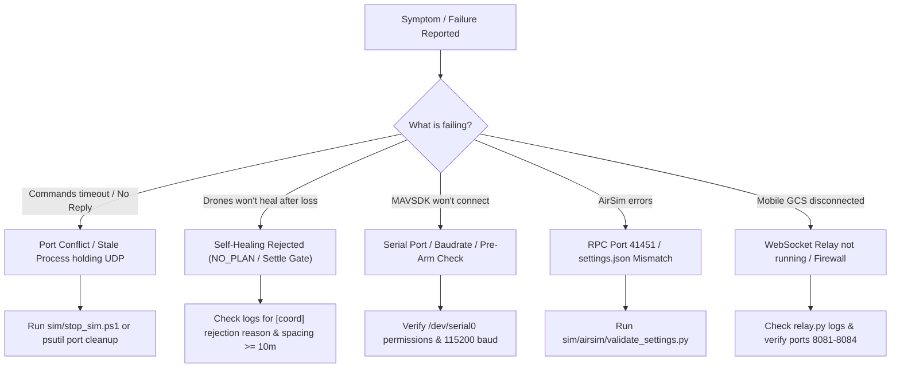

# Handoff: Troubleshooting Runbook & FAQ

## 1. Quick Diagnostic Flowchart



---

## 2. Common Issues & Solutions

### 2.1 "no_reply" / Commands Silently Ignored
- **Symptom:** GCS sends commands (e.g. Arm, Takeoff, Formation), but the drone emits no reply and does not execute.
- **Root Cause:** A stale or orphaned DroneOS or relay process from an earlier test run is still bound to the drone's UDP port (`14550`-`14553`). The new instance fails to bind and never receives traffic.
- **Remedy:**
  - **On Windows:** Run `powershell -ExecutionPolicy Bypass -File sim/stop_sim.ps1`.
  - **On Linux / Raspberry Pi:**
    ```bash
    # Kill any process holding port 14550
    sudo fuser -k 14550/udp
    # Restart the systemd service
    sudo systemctl restart phoneos-drone1
    ```

---

### 2.2 Self-Healing Rejection (`NO_PLAN`)
- **Symptom:** A follower or anchor drone dies, but the surviving swarm logs `NO_PLAN` and does not heal.
- **Diagnostic Check:** Look for `[coord]` log lines in the anchor drone's console:
  1. `[coord] NO_PLAN: min separation X < Y between droneA and droneB`
     - **Cause:** Formation spacing is too small (e.g. $< 10.0\text{ m}$). Collision avoidance guards reject paths that bring surviving aircraft within safety envelopes.
     - **Fix:** Set formation spacing to at least `12.0 m` or `15.0 m`.
  2. `[coord] Reslot cooldown not elapsed (Xs remaining)`
     - **Cause:** A previous heal or formation change happened less than `reslot_cooldown_s` (5.0 s) ago.
     - **Fix:** Settle gates will naturally elapse; wait for stabilization.
  3. `[coord] Quorum is not QUORUM (current: SPLIT_BRAIN_HAZARD)`
     - **Cause:** More than half the cluster is dead (e.g. 2 drones dead in a 4-drone swarm). Healing is intentionally blocked to prevent split-brain collisions.
     - **Fix:** Surviving drones will hover or RTL.
  4. `[coord] Max heals reached (3/3)`
     - **Cause:** Aircraft has already healed 3 times during this battery session.
     - **Fix:** Land or power-cycle the aircraft to reset the session heal counter.

---

### 2.3 MAVSDK Serial Connection & Pre-Arm Failures
- **Symptom:** `px4_adapter.py` logs `ConnectionRefusedError` or fails during `arm()`.
- **Diagnostic Checklist:**
  1. **Dialout Permissions:** Confirm user `pi` belongs to group `dialout` (`sudo usermod -a -G dialout pi`).
  2. **Baudrate Mismatch:** Confirm `px4_connection_string` in `configs/flight.yaml` matches Pixhawk's `SER_TEL2_BAUD` parameter (typically `115200` or `921600`).
  3. **Pixhawk Pre-Arm Sensors:** PX4 refuses to arm if:
     - Compass or accelerometer calibration is missing.
     - GPS satellite lock is below threshold ($< 10$ satellites or HDOP $> 2.0$).
     - Kill switch or hardware safety switch is engaged.
  4. Inspect `journalctl -u phoneos-drone1 -f` for MAVSDK status text messages emitted directly by Pixhawk.

---

### 2.4 AirSim Simulation Connection Issues
- **Symptom:** `AirSimAdapter` logs `Cannot connect to AirSim RPC at 127.0.0.1:41451`.
- **Diagnostic Checklist:**
  1. Ensure the Unreal Engine binary (e.g. `Blocks.exe`) is running and active **before** launching `launch_sim.bat`.
  2. Confirm `settings.json` is located in your Documents folder (`~/Documents/AirSim/settings.json`) and run:
     ```bash
     python sim/airsim/validate_settings.py
     ```
  3. Verify vehicle naming: In `settings.json`, vehicle names must be capitalized (`Drone1`, `Drone2`, `Drone3`, `Drone4`).

---

### 2.5 Mobile GCS Cannot Connect to Relays
- **Symptom:** Status badges on GCS remain gray or red (`DISCONNECTED`).
- **Diagnostic Checklist:**
  1. Confirm the relay process is running:
     ```bash
     # Check listening ports on Windows:
     netstat -ano | findstr "8081"
     # Check on Linux:
     ss -tuln | grep 8081
     ```
  2. **Firewall:** Windows Defender or Linux `ufw` may block incoming connections on ports `8080`-`8084`. Add an inbound rule allowing TCP traffic on these ports.
  3. **Authentication Token:** If `RELAY_AUTH_TOKEN` is set on the companion computer, ensure the same token is entered in **Settings** on the GCS.

