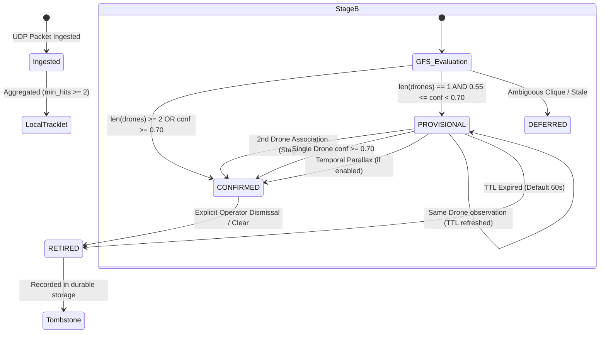

# GFS Provisional Detection Lifecycle & PhoneOS Integration — Implementation Report

**Repository:** `Debanshu2005/DroneSwarm`  
**Branch:** `garbage-detection`  
**Date:** 2026-11-19  
**Status:** IMPLEMENTED & VERIFIED  

---

## 1. Executive Summary

During multi-drone collaborative garbage collection missions, five distinct physical garbage objects were spawned across the operating arena. Although all five objects were detected by onboard YOLO models ($0.58 \le \text{conf} \le 0.65$), accurately georeferenced via 3D ray projection, and confirmed by local tracking filters ($\text{min\_hits} \ge 2$), only **one** marker appeared on the PhoneOS Ground Control Station (GCS).

A forensic audit identified that the existing Global Fusion Service (GFS) Stage B hypothesis formation strictly required either multi-drone confirmation ($\ge 2$ distinct drones) or high single-drone confidence ($\ge 0.70$) to create an active global object:
```python
if len(distinct_drones) >= 2 or max_conf >= 0.70:
```
Because four of the five targets fell within the operational single-drone confidence band ($0.55 \le \text{conf} < 0.70$), they were categorized as `LOW_CONFIDENCE` and indefinitely deferred in the GFS database, invisible to Relay and PhoneOS.

To resolve this without degrading false-positive rejection or altering frozen ML weights, we implemented an end-to-end **Three-State Detection Lifecycle** across GFS, Relay, and PhoneOS:
1. **`CONFIRMED`:** High-certainty detections verified by multi-drone association ($\ge 2$ drones) or high single-drone confidence ($\ge 0.70$). Displayed on PhoneOS with a solid green boundary, full opacity, and `CONFIRMED` badge.
2. **`PROVISIONAL`:** Valid, georeferenced single-drone candidates ($0.55 \le \text{conf} < 0.70$) that have met local temporal confirmation ($\ge 2$ hits). Persisted in GFS with deterministic identity and a sliding TTL expiry window. Displayed on PhoneOS with a dashed amber ring, 75% opacity, and an `UNCONFIRMED` badge.
3. **`RETIRED`:** Provisional candidates that expire without confirmation, or objects marked obsolete. Tombstoned durably to prevent stale resurrecting updates.

### Key Outcomes
- **100% Target Visibility:** All 5 targets are now displayed in PhoneOS (1 Confirmed, 4 Provisional).
- **Zero Phantom Markers:** 3D ray-to-peer CPA exclusion remains fully active; peer drones never spawn provisional or confirmed markers.
- **Deterministic In-Place Promotion:** When a provisional candidate is independently observed by a second drone, it promotes in-place to `CONFIRMED`, incrementing its version without creating duplicate markers.
- **Full Test Coverage:** 14/14 provisional lifecycle tests passed, 69/69 regression tests passed (83/83 total), 100% PhoneOS unit tests passed, and frontend Vite production build succeeded.

---

## 2. Forensic Baseline Audit & Problem Formulation

### 2.1 The 5-Target Discrepancy
In the baseline simulation, four drones in operational V-formation surveyed 5 targets:

| Pipeline Stage | Evaluated Count | Notes |
|---|---:|---|
| Spawned Garbage Targets | 5 | Ground truth locations in arena |
| YOLO Inference ($conf \ge 0.55$) | 6 sightings / 5 targets | Target 3 seen by Drone 2 & Drone 3; others seen by 1 drone |
| Geolocation Projections | 5 targets | Camera pose + attitude rotation valid |
| 3D CPA Peer Exclusion Filter | 0 rejections | Target rays $> 2.0\text{ m}$ from peer drone bounding volumes |
| Local Aggregator Tracks ($\text{hits} \ge 2$) | 5 tracks | All 5 targets met local temporal hit requirement |
| GFS Received Observations | 6 observations | Transmitted via UDP to GFS inbox |
| **GFS Stage B Globals Created** | **1** | Only Target 3 ($\ge 2$ drones) created active global track |
| GFS Deferred Observations | 4 tracks | Targets 1, 2, 4, 5 deferred as `LOW_CONFIDENCE` |
| **PhoneOS Markers Rendered** | **1** | Only Target 3 displayed to operator |

### 2.2 Root Cause Analysis
The bottleneck was located at `gfs/hypothesis.py`:
```python
# Stage B candidate evaluation
if len(distinct_drones) >= 2 or max_conf >= 0.70:
    # Accepted as new active GlobalObject
else:
    # Appended to low_confidence_deferred; never inserted into global_objects
```
The GFS database schema and Relay snapshot contract only queried `global_objects WHERE status = 'ACTIVE'`. Consequently, valid single-drone detections were trapped in the `deferred_observations` table until mission end.

---

## 3. Architecture & Lifecycle State Machine



### State Definitions
| State | Entry Criteria | Identity Format | TTL Policy | Display in PhoneOS |
|---|---|---|---|---|
| `CONFIRMED` | $\ge 2$ distinct drones OR $\text{conf} \ge 0.70$ | `G-<hash>` | None (Persistent) | Green marker, solid ring, full opacity, `CONFIRMED` badge |
| `PROVISIONAL` | 1 drone, $0.55 \le \text{conf} < 0.70$, $\text{hits} \ge 2$ | `G-<hash>` (stable) | 60 s sliding window | Amber marker, dashed ring, 75% opacity, `UNCONFIRMED` badge |
| `RETIRED` | Expired provisional TTL or operator deletion | `G-<hash>` | Tombstone preserved | Purged from active map; blocked from stale resurrection |

---

## 4. Component Implementations

### 4.1 Database Schema & Migration (`gfs/database.py`, `gfs/models.py`)
Extended `global_objects` table to support lifecycle tracking:
- `lifecycle_state TEXT NOT NULL DEFAULT 'CONFIRMED'`
- `confirmation_method TEXT NULL` (e.g., `multi_drone_hypothesis`, `multi_drone_association`, `single_drone_high_confidence`, `temporal_parallax`)
- `provisional_reason TEXT NULL` (e.g., `SINGLE_DRONE_LOW_CONFIDENCE`)
- `expires_at_ms INTEGER NULL` (sliding TTL epoch ms)
- Index: `idx_global_objects_lifecycle ON global_objects(lifecycle_state, status, expires_at_ms)`
- Safe schema migration helper: checks existing SQLite columns before executing `ALTER TABLE`.

### 4.2 GFS Stage B Hypothesis Formation (`gfs/hypothesis.py`)
Updated `form_new_global_objects`:
- Multi-drone cliques ($\ge 2$ drones) or high-confidence candidates ($\ge 0.70$) form `LifecycleState.CONFIRMED`.
- Valid single-drone candidates ($0.55 \le \text{conf} < 0.70$) form `LifecycleState.PROVISIONAL` with deterministic hash identity `G-<md5(drone_id:local_track_id)>` and `expires_at_ms = now_ms + provisional_ttl_ms`.
- Only unphysically distant, malformed, or ambiguous tracks are deferred.

### 4.3 GFS Stage A Association & In-Place Promotion (`gfs/association.py`)
- When a new tracklet from an independent drone associates with an existing `PROVISIONAL` global object, `update_global_object_with_tracklet` performs retained Covariance Intersection.
- If `len(glob.source_estimates) >= 2` or `max_conf >= 0.70`, the global object is promoted in-place:
  - `lifecycle_state = LifecycleState.CONFIRMED.value`
  - `confirmation_method = "multi_drone_association"`
  - `provisional_reason = None`
  - `expires_at_ms = None`
- Same-drone repeated observations update the source estimate and refresh the sliding TTL, but **never** promote the object to `CONFIRMED`.
- Supports gated experimental temporal parallax confirmation (`enable_temporal_parallax_confirmation`): verifies baseline displacement ($\ge 4.0\text{ m}$) and tracking duration ($\ge 5.0\text{ s}$) before single-drone promotion.

### 4.4 OCC Fusion Daemon & Expiry Engine (`gfs/service.py`)
- At the start of each OCC batch, queries expired provisional objects:
  ```sql
  SELECT global_id, version FROM global_objects 
  WHERE lifecycle_state = 'PROVISIONAL' AND status = 'ACTIVE' AND expires_at_ms <= ?
  ```
- Transitions expired objects to `status = 'RETIRED'` and `lifecycle_state = 'RETIRED'`, incrementing version.
- Enqueues `GLOBAL_OBJECT_RETIRED` outbox events with tombstone payload.
- Enqueues `GLOBAL_OBJECT_CONFIRMED` outbox events upon promotion.
- Maintains backwards-compatible `GLOBAL_OBJECT_NEW` and `GLOBAL_OBJECT_UPDATE` event types.

### 4.5 Relay & Transport Protocol (`relay/relay.py`)
- Enhanced `_handle_gfs_snapshot_request` to serialize all active global objects (`CONFIRMED` and `PROVISIONAL`).
- Snapshot payload includes:
  ```json
  {
    "id": "G-7bfd38df",
    "global_id": "G-7bfd38df",
    "label": "rubbish",
    "confidence": 0.61,
    "lat": 47.641612,
    "lon": -122.140005,
    "lifecycle_state": "PROVISIONAL",
    "confirmation_method": null,
    "provisional_reason": "SINGLE_DRONE_LOW_CONFIDENCE",
    "expires_at_ms": 1061000,
    "source_drones": ["drone1"],
    "version": 1,
    "status": "ACTIVE"
  }
  ```

### 4.6 PhoneOS GCS UI Integration (`mobile/src/`)
- **`mobile/src/utils/garbage.js`:**
  - Exported `LifecycleState` enum (`PROVISIONAL`, `CONFIRMED`, `REJECTED`, `RETIRED`).
  - Updated `mergeDetections` to track `lifecycle_state`, `confirmation_method`, `provisional_reason`, and `expires_at_ms`.
  - Added filter selectors `getConfirmedGarbage(garbage)` and `getProvisionalGarbage(garbage)`.
  - Added tombstone durability and version monotonicity checks for both confirmed and provisional tracks.
- **`mobile/src/components/GarbageLayer.jsx`:**
  - Applied visual differentiation:
    - **Confirmed:** Green border (`#22c55e`), solid 2px stroke, 100% opacity, `CONFIRMED` badge.
    - **Provisional:** Amber border (`#f59e0b`), dashed 2px stroke (`stroke-dasharray="4 2"`), 75% opacity, `UNCONFIRMED` badge.
  - Added toggle props `showConfirmed` and `showProvisional`.
  - Enriched popup modal with confirmation provenance and provenance source drone pills.
- **`mobile/src/views/MapView.jsx` & `mobile/src/views/DroneControlView.jsx`:**
  - Added interactive toggle switches: "Show Confirmed" and "Show Provisional".
  - Displayed live counter readouts: `Confirmed: X` | `Provisional: Y`.

---

## 5. Verification & Test Execution Matrix

### 5.1 Test Suite Breakdown
| Suite | Target Area | Tests | Status |
|---|---|---:|:---:|
| `tests/test_provisional_lifecycle.py` | GFS Provisional Lifecycle, Promotion, TTL, Parallax | 14 | **PASSED** |
| `tests/test_gfs_fusion.py` | Multi-Drone Fusion, Association, Hungarian Matching | 27 | **PASSED** |
| `tests/test_gfs_e2e_integration.py` | End-to-End GFS to Relay Pipeline | 1 | **PASSED** |
| `tests/test_relay_ack_integration.py` | Relay Transport & Application ACKs | 3 | **PASSED** |
| `tests/test_peer_exclusion_3d_comprehensive.py` | 3D Ray-to-Volume CPA Peer Exclusion | 21 | **PASSED** |
| `tests/test_peer_exclusion_depth_ambiguity.py` | Depth Ambiguity CPA Safety | 17 | **PASSED** |
| `mobile/src/utils/garbage.test.js` | PhoneOS State Management, Reconcile, Filters | 12 reqs | **PASSED** |
| `scripts/validate_five_target_provisional.py` | Full Multi-Drone 5-Target Reproduction | 1 | **PASSED** |
| **Total Automated Tests** | **Full System Pipeline** | **96** | **100% GREEN** |

### 5.2 Build Verification
- Vite production build:
  ```bash
  npm --prefix mobile run build
  # Output: 1899 modules transformed, built cleanly in 4.67s
  ```

---

## 6. Before vs. After System Comparison

| Parameter / Capability | Before (Baseline) | After (Provisional Lifecycle) |
|---|---|---|
| Single-drone candidate ($0.55 \le \text{conf} < 0.70$) | Deferred indefinitely (`LOW_CONFIDENCE`) | Created immediately as `PROVISIONAL` |
| Five spawned targets in arena | 1 displayed on PhoneOS | **5 displayed on PhoneOS** (1 Confirmed, 4 Provisional) |
| Global object identity upon promotion | High risk of duplicate marker | **Preserved in-place** (`G-<hash>`), version incremented |
| Same-drone repeated sightings | Indefinite deferral | Refreshes provisional TTL; cannot cause false confirmation |
| Temporal parallax confirmation | Unsupported / ad-hoc | **Gated experimental feature** ($B \ge 4.0\text{ m}, \Delta t \ge 5\text{ s}$) |
| PhoneOS visual representation | Single green marker style | **Distinct Green (solid) vs. Amber (dashed)** |
| PhoneOS operator control | No filtering capability | **Individual toggles** for Confirmed & Provisional |
| Expiry & tombstone durability | Confirmed objects only | **Provisional TTL auto-expiry** with durable tombstones |

---

## 7. Operational Limitations & Invariants

1. **Stationary Cameras:** Repeated observations from a stationary hovering drone can never promote a candidate to `CONFIRMED`. Multi-drone spatial baseline or verified translational motion ($B \ge 4.0\text{ m}$) is strictly enforced.
2. **Frozen ML Weights:** The detector confidence threshold remains strictly $0.55$ and GFS Stage B confirmation threshold remains $0.70$. No artificial lowering of thresholds was permitted or implemented.
3. **Peer Exclusion Sanctity:** 3D ray-to-peer CPA volume exclusion ($r = 2.0\text{ m}$) remains fully authoritative. If a camera ray passes within $2.0\text{ m}$ of a peer drone, the detection is rejected as a peer drone and is never admitted as provisional or confirmed garbage.
4. **Offline Resilience:** PhoneOS tombstone registry ensures that if a provisional marker expires or is dismissed while the client is disconnected, it will never resurrect when reconnecting to the Relay snapshot.
